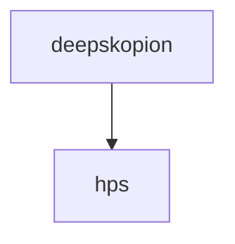

<!-- rr:fdd v1 ip=deepskopion -->
# deepskopion — Firmware Design Document

Facts verified against `f5195e2f` on 2026-10-20.

<!-- rr:fdd:generated:begin -->
<!-- rr:fdd:inputs sha256:373f3d6a0ee2180c -->
<!-- rr:fdd:projection v3 -->
> Machine-owned block — scaffolded by `rr fdd init`, refreshed by
> `rr fdd generate`. Do not edit inside the markers;
> edit the canonical declarative files it references. FDD state is
> documentation completeness only — never behavioral proof.

**IP:** `deepskopion` v0.1

## Canonical References

- **Requirements** — `requirements.yml`: DS-SYS-PORT-001 (negative), DS-SYS-CLK-001 (behavioral), DS-SYS-DDR-001 (behavioral), DS-SYS-REG-001 (behavioral)
- **Interfaces** — `requirements.yml` port_contract:
  - `canfd0_apb` — apb slave
  - `canfd1_apb` — apb slave
  - clocks: `clk_sys_i`, `clk_ddr_i`, `mss_spi_clk_i`
  - resets: `rst_sys_i`, `rst_ddr_i`
  - 79 scalar port(s)
  - parameters: `G_DDR_BASE_ADDR`=x"1000_0000", `G_DDR_WIN_WIDTH`=28, `G_AXI_MAX_BURST`=16, `G_DDR_DATA_WIDTH`=128, `G_SYS_CLK_HZ`=100_000_000, `G_DDR_BACKEND`=axi
  - _contract_: declared here from the contract — not proof the HDL matches; verify with `rr sim contract-check`
- **Registers** — `project_regbank.yml`
- **Dependencies** — `ip.yml` build.ips: `hps`
- **Decisions** — no `decisions.yml`

## Requirements

| ID | Kind | Requirement |
|---|---|---|
| DS-SYS-PORT-001 | negative | deepskopion_core must not reference a vendor primitive library (unisim, altera, intel), a vendor FIFO, the Vivado block design, or a vendor REA wrapper; vendor logic lives only in the target tops. |
| DS-SYS-CLK-001 | behavioral | Every clock-scaled generic of a datalogger-path instance in deepskopion_core is driven from G_SYS_CLK_HZ, never a literal, and G_SYS_CLK_HZ equals the clk_sys frequency of each target top. |
| DS-SYS-DDR-001 | behavioral | deepskopion_core passes G_DDR_BASE_ADDR to the DDR stream writer as a full 32-bit vector, so a ring base at or above 0x80000000 (0xA0000000 on DE25 and PolarFire SoC) elaborates without integer conversion. |
| DS-SYS-REG-001 | behavioral | The constant registers of project_regbank.yml match their sources: REGBANK_VERSION equals the packed regbank version, CONTRACT_ABI_VER equals the core constant, and RING_BYTES equals 2**G_DDR_WIN_WIDTH with G_DDR_WIN_WIDTH = 28 in every target top. |

## Register Map

| Register | Address | Access | Description |
|---|---|---|---|
| GIT_HASH | 0x00 | RO | Git commit hash of the build |
| SYSTEM_VERSION | 0x04 | RO | System firmware version (semantic versioning) |
| BUILD_DATE | 0x08 | RO | Build timestamp (Unix epoch) |
| REGBANK_VERSION | 0x0C | RO | Register bank version (encoded as major.minor.patch) |
| REGBANK_NUM_WORDS | 0x10 | RO | Number of words in the register bank schema (manifest). Reading this register also resets the streaming pointer for REGBANK_DATA to 0. |
| REGBANK_DATA | 0x14 | RO | Streaming-read port for the regbank manifest ROM. Each read returns the next 32-bit word from regbank_schema.hex and advances the internal pointer. Read REGBANK_NUM_WORDS first to seed the count + reset pointer. |
| CONFIG_NUM_WORDS | 0x18 | RO | Number of words in the build configuration manifest (which dataloggers + how many are baked into this bitstream). Reading this register also resets the streaming pointer for CONFIG_DATA to 0. |
| CONFIG_DATA | 0x1C | RO | Streaming-read port for the build-config ROM (config_schema.hex). Each read returns the next 32-bit word and advances the pointer. See datalogger_gather_gen.py for the v0.1 encoding (magic 0xC0A1DE01 + count + per-instance words). |
| DATALOGGER_CONFIG | 0x20 | RW | Per-datalogger runtime control word. Low 16 bits drive datalogger_gather.CONFIG via the config_control demux. CONFIG[15:11] selects the addressed datalogger_id; CONFIG[10:0] is the per-datalogger payload (e.g. CONFIG[0]=enable). See docs/standards/datalogger_compliance_checklist.md section 4. |
| EMIO_MUX_SEL | 0x24 | RW | Per-protocol pre-gather source selector. Bit[0]=I2C |
| CONTRACT_ABI_VER | 0x28 | RO | RTL<->PS-software contract ABI version, driven by deepskopion_top from C_CONTRACT_ABI_VER. Mirror of sw.stream.testbench.provenance.CONTRACT_ABI_VER; run_self_test compares the two at startup and ERRORs (exit 2, harness-broken) on mismatch so version-skew can never be read as a DUT verdict. Reads 0 on bitstreams that predate ABI versioning (self-test treats 0 as "unversioned" -> warn, not error). Bump major on any breaking change to the EMIO injector load/edge-detect contract. |
| EMIO_PROBE | 0x2C | RO | EMIO-loop probe tap. Live snapshot of the EMIO loopback seam — the same 31-bit probe_word fed to the rr_rea_xilinx7 REA core in deepskopion_top, plus bit[31]=REA-triggered sticky. Read over AXI/devmem for a static "does the EMIO signal reach the injector/datalogger, does the injector drive back" check without a JTAG capture. Bit map (LSB-first) is documented in debug/emio_seam.yml; the REA core gives the cycle-accurate waveform of the same bits. |
| I2C_INJ_CONTROL | 0x30 | RW | I2C injector control. Bit[0]=enable. Bits[7:1]=slave 7-bit address. Bit[9]=fifo_reset (self-clearing). Remaining bits reserved. |
| I2C_INJ_DATAIN | 0x34 | RW | I2C injector TX-FIFO write strobe. Each PS write pushes the low 8 bits into the slave's TX FIFO; the slave returns those bytes on master-read transactions in FIFO order. |
| I2C_INJ_STATUS | 0x38 | RO | I2C injector status. Bit[0]=fifo_empty. Bit[1]=fifo_prog_full. Bit[2]=slave error sticky. Bits[9:3]=fifo data count (depth+1 wide). |
| SPI_INJ_CONTROL | 0x40 | RW | SPI injector control. Bit[0]=enable. Bit[9]=fifo_reset (self-clearing). Bits[8:1] + remaining reserved for future SPI mode bits. |
| SPI_INJ_DATAIN | 0x44 | RW | SPI injector TX-FIFO write strobe. Each PS write pushes the low 8 bits into the slave's TX FIFO; the slave drives MISO with those bytes on the next master transaction. |
| SPI_INJ_STATUS | 0x48 | RO | SPI injector status. Bit[0]=fifo_empty. Bit[1]=fifo_prog_full. Bits[9:3]=fifo data count. Bit[2] reserved (no slave-side error path in v1). |
| CLK_DDR_TICKS | 0x4C | RO | clk_ddr (fclk_clk1, 125 MHz) liveness edge-count. A free-running divide-by-256 toggle in the clk_ddr domain (NO rst_ddr dependence) is CDC'd to clk_sys and edge-counted. Read twice ~100 ms apart - a nonzero delta proves clk_ddr is running; a stuck value means the HP0 DMA write clock is dead. Distinguishes 'dead clock' from 'stuck reset' (see DDR_RESET_STATUS). |
| DDR_RESET_STATUS | 0x50 | RO | rst_ddr (HP0 DMA-domain reset) observed in clk_sys. Bit[0]=live rst_ddr (1=asserted/held in reset). Bit[1]=sticky 'rst_ddr ever deasserted since config' (latches 1 the first time reset releases; never clears). Bit[2]=ddr_write_idle - the DMA write side is IDLE, all enqueued frames are committed to DRAM; when set, the PS may safely read the ring up to RING_WRITE_PTR (the robust RingOracle 'caught up' signal, PS-LOOP-REQ-9). If bit[1]=0 the DDR write FSM never came out of reset. Write-plane arming (previously-reserved upper bits, backward-compatible - old readers masked them as 0). Bit[6:3]=dbg_reset_status_o synced {downloader_cs, uploader_cs, pipeBusyDdr, pipeBusy}. Bit[7]=chip_empty - the CDC empty flag the uploader uses to decide there is data to write; STUCK 1 means the uploader sees no data and never arms (the key divergence probe). Bit[8]=pipe empty. Bit[9]=user FIFO full. Bit[10]=write_error (BRESP/=OKAY sticky). Bit[16:11]=sticky 'ever seen since rst_ddr' {aw_valid(11), aw_handshake(12), wvalid(13), bvalid(14), write_active/idle-ever-0(15), write_error(16)} - aw_valid=0 forever is the 'no AW ever issued' wedge; a working 0.3.1 build sets aw_valid/aw_handshake/bvalid/write_active. Bit[31:17]=reserved 0. |
| HEARTBEAT_CNT | 0xC0 | RO | Free-running PL heartbeat counter (liveness check) |
| FIFO_OVERFLOW_CNT | 0xC4 | RO | FIFO overflow event count (persistent) |
| FIFO_OVERFLOW_CNT_RSVD | 0xC8 | RO | RESERVED — deprecated Stream-tier FIFO overflow count (D.4 single-tier arbiter); reads 0; slot retained for address stability (remove in a future migration) |
| PKT_CNT_I2C | 0xD0 | RO | I2C accepted message count |
| PKT_CNT_SPI | 0xD4 | RO | SPI accepted message count |
| PKT_CNT_UART | 0xD8 | RO | UART accepted message count |
| PKT_CNT_QSPI | 0xDC | RO | QSPI accepted message count |
| PKT_CNT_EDGE | 0xE0 | RO | Edge detector event count |
| PKT_CNT_I2S | 0xE4 | RO | I2S stream sample count |
| PKT_CNT_CAN | 0xE8 | RO | CAN accepted message count |
| PKT_CNT_JTAG | 0xEC | RO | JTAG accepted message count |
| ERR_CNT_I2C | 0xF0 | RO | I2C protocol error count |
| ERR_CNT_SPI | 0xF4 | RO | SPI protocol error count |
| ERR_CNT_UART | 0xF8 | RO | UART frame/parity error count |
| ERR_CNT_QSPI | 0xFC | RO | QSPI protocol error count |
| ERR_CNT_EDGE | 0x100 | RO | Edge detector error count |
| ERR_CNT_CAN | 0x104 | RO | CAN protocol error count |
| ERR_CNT_JTAG | 0x108 | RO | JTAG protocol error count |
| ARB_GRANT_CNT | 0x110 | RO | Arbiter total grant count |
| ARB_GRANT_CNT_RSVD | 0x114 | RO | RESERVED — deprecated Stream-tier arbiter grant count (D.4); reads 0; slot retained for address stability |
| DROP_CNT_I2C | 0x120 | RO | I2C messages dropped (VLD && !RDY) |
| DROP_CNT_SPI | 0x124 | RO | SPI messages dropped (VLD && !RDY) |
| DROP_CNT_UART | 0x128 | RO | UART messages dropped (VLD && !RDY) |
| FIFO_HIGH_WATERMARK | 0x130 | RO | Peak FIFO occupancy since reset |
| FIFO_HIGH_WATERMARK_RSVD | 0x134 | RO | RESERVED — deprecated Stream-tier peak FIFO occupancy (D.4); reads 0; slot retained for address stability |
| TELEMETRY_CTRL | 0x140 | RW | Write bit[0]=1 to clear all telemetry counters. Self-clearing. |
| TELEMETRY_SNAPSHOT_TRIGGER | 0x144 | RW | Write bit[0]=1 to latch all counters atomically. Self-clearing. |
| RING_WRITE_PTR | 0x150 | RO | Number of 32-bit messages written into the ring since reset (free-running, wraps at 2^32). PS computes byte offset = (RING_WRITE_PTR * 4) mod RING_BYTES. |
| RING_READ_PTR | 0x154 | RW | Software-managed ring DRAIN pointer (byte offset, mod RING_BYTES — NOT the old message count). SW writes the byte offset it has CONSUMED up to, same frame/units as RING_COMMIT_PTR. Wired to ddr_stream_axi.csr_rd_ptr_addr_i (load strobe held high); the IP frees the corresponding ring space so the DMA write pointer auto-wraps — continuous, lossless SPSC drain, no double-read (the PS already has the data from mmap; it only advances the pointer). Defaults to 0 at reset → ring fills once and stalls (legacy write-only behaviour) until SW starts advancing it. If the PS falls behind, the producer stalls correctly (see DROP_CNT / ring-full feedback). |
| RING_BASE_LOW | 0x158 | RO | Physical base address of the ring buffer in PS DDR, low 32 bits. Matches deepskopion_top.G_DDR_BASE_ADDR (default 0x10000000). |
| RING_BASE_HIGH | 0x15C | RO | Physical base address of the ring buffer in PS DDR, high 32 bits. Always 0 on Zynq-7 (32-bit physical address space). |
| RING_BYTES | 0x160 | RO | Size of the ring buffer in bytes. Matches 2^deepskopion_top.G_DDR_WIN_WIDTH (default 2^28 = 256 MB). |
| RING_COMMIT_PTR | 0x164 | RO | PS-LOOP-REQ-9. The live DMA write (commit) DDR address from ddr_stream_axi.wr_commit_addr_o — where the HP0 DMA has ACTUALLY written, not where the enqueue counter (RING_WRITE_PTR) has reached. The RingOracle MUST walk the ring only up to (RING_COMMIT_PTR - RING_BASE_LOW), not RING_WRITE_PTR*4, to avoid reading un-committed regions. NOTE - 2-FF-synced from clk_ddr so it may bit-skew mid-transition; combine with DDR_RESET_STATUS bit2 (ddr_write_idle, the DMA-caught-up flag) for the exact tail. Reads 0 until the first write. |
| DDR_BACKPRESSURE_CNT | 0x168 | RO | Free-running 32-bit count of clk_sys cycles where the framer has a frame to write but the DDR DMA can't accept it (framer_out_valid && !ddr_s_axis_ready) — i.e. the ring is FULL and incoming real-time datalogger traffic is being silently lost UPSTREAM of the per-protocol DROP_CNT/ERR_CNT (which stay 0 because the datalogger can't even form a frame). A climbing value is the out-of-band 'consumer fell behind, losing data NOW' signal that no handshake-level counter sees. Pairs with the per-protocol DROP_CNT (arbiter backpressure) and the ring-fill watermark IRQ (RING_ALARM_CNT). Reads 0 while a consumer keeps the ring draining (commit wraps forever). |
| RING_ALARM_CNT | 0x16C | RO | Ring-fill watermark alarm. bits[30:0] = number of times the ring fill crossed the HIGH watermark (75% of RING_BYTES) — exactly one increment per fill excursion thanks to the hysteresis latch (set at 75%, cleared only after the consumer drains below the LOW watermark = 50%). bit[31] = the LIVE alarm level (the same signal wired to IRQ_F2P[0], level-high → GIC SPI |
| EMIT_VALID_CNT | 0x170 | RO | Probe. Saturating count of clk_sys cycles where error_event_emitter holds a pending in-band loss frame (err_fr_valid=1). >0 proves the emitter latched a SEV_ERROR report on silicon when the edge FIFO overflowed; =0 means it never latched (emitter/ERR_CNT-wiring issue). Pairs with EMIT_DONE_CNT to localise where piece-3's loss frame is lost (framer→uploader→DDR). |
| EMIT_DONE_CNT | 0x174 | RO | Probe. Saturating count of emitter→framer input handshakes (err_fr_valid AND err_fr_ready=framer IN_READY). >0 proves the framer ACCEPTED the loss frame → the loss is DOWNSTREAM in the ddr_stream_axi uploader; =0 with EMIT_VALID_CNT>0 proves the framer never accepted it (the framer is never in S_IDLE while err_fr_valid holds — mux/idle starvation). Read both after forcing an overflow (pin RING_READ_PTR ahead of commit) to discriminate. |
| EYE_CONTROL | 0x200 | RW | Eye-scan control word. Bit[0]=start — a 0→1 transition launches one measurement (CSR-pulse idiom; write 0 then 1 to re-arm). Bit[1]=aggressor_en — drive the adjacent PMOD pin with an uncorrelated PRBS (crosstalk mode) for the duration of the run. Bit[2]=selftest — internal TX→RX loopback (bypass PMOD+IDELAY). Bits[9:4]=phase_sel — IDELAYE2 tap (0..31, fine sub-step phase axis) feeding idelay_scan on the RX loopback pin. Bits[15:12]=freq_sel — clk_drp MMCM-DRP frequency-profile index (the eye's frequency axis). Bits[18:16]=sample-clock phase-shift command (full-UI axis) — bit[16]=ps_step — a 0→1 transition advances the CLKOUT1 sample_clk phase by one MMCM fine step (≈17.86 ps); bit[17]=ps_incdec (1=advance/0=retard); bit[18]=ps_rst — a 0→1 transition zeroes the fabric phase-step counter (EYE_PHASE_STATUS). Poll EYE_PHASE_STATUS.ps_busy=0 between steps. A freq_sel change relocks the MMCM and re-zeroes the actual sample phase. Remaining bits reserved (read 0). |
| EYE_BIT_TARGET | 0x204 | RW | Eye-scan measurement length. Number of PRBS bit periods to DRIVE for one (freq,phase) point. The self-syncing checker accrues BIT_COUNT only post-lock, so the measured EYE_BIT_COUNT is BIT_TARGET minus the lock latency (~ORDER+lock-threshold+loopback-delay). Larger targets lower the measurable BER floor (floor ≈ 1/BIT_COUNT). 0 = defined no-op (engine DONEs with no measurement). |
| EYE_STATUS | 0x208 | RO | Eye-scan engine status. Bit[0]=busy (a measurement is in flight). Bit[1]=done (the last measurement finished; counters frozen and valid to read). Bit[2]=locked (the checker self-synchronised to the loopback PRBS this run — 0 with done=1 means the link was dead/too-closed at this point, i.e. a genuine eye-closed cell, NOT a tooling error). Poll until done=1, then read the counters. |
| EYE_ERR_COUNT_LO | 0x20C | RO | Eye-scan bit-error count, low 32 bits. Detected received-bit errors over the post-lock window of the last measurement. Combine with EYE_ERR_COUNT_HI for the full 48-bit count. Each isolated line error appears as (taps+1)=3 detected errors via the self-syncing descrambler — the host's BER = ERR/BIT inherits the same factor consistently across all cells, so relative eye shape is exact. |
| EYE_ERR_COUNT_HI | 0x210 | RO | Eye-scan bit-error count, high 16 bits in bits[15:0]; bits[31:16] read 0. Forms the upper half of the 48-bit error counter with EYE_ERR_COUNT_LO. |
| EYE_BIT_COUNT_LO | 0x214 | RO | Eye-scan measured-bit count, low 32 bits. Bits actually checked post-lock in the last measurement (the BER denominator). Combine with EYE_BIT_COUNT_HI for the full 48-bit count. A value of 0 with EYE_STATUS.done=1 means the engine never locked → no measurement for this (freq,phase) cell (eye fully closed / link dead), distinct from a measured BER of 0. |
| EYE_BIT_COUNT_HI | 0x218 | RO | Eye-scan measured-bit count, high 16 bits in bits[15:0]; bits[31:16] read 0. Forms the upper half of the 48-bit bit counter with EYE_BIT_COUNT_LO. |
| EYE_PHASE_STATUS | 0x21C | RO | Eye-scan sample-clock phase-shift status. Bits[15:0]=ps_count — the net number of MMCM fine phase steps applied to the CLKOUT1 sample_clk since the last ps_rst / freq reconfig (a signed-magnitude walk, +1 per advance step and −1 per retard, two's-complement in 16 bits). Multiply by ~17.86 ps (VCO_period/56 at the 1000 MHz VCO) for the absolute sample-phase offset; one full UI = (1000/D)·... ≈ 56·D/10 steps. Bit[16]=ps_busy — a phase step (EYE_CONTROL.ps_step) is in flight; poll until 0 before issuing the next step or trusting ps_count. ADD-only slot — shared system_regbank, canfd_demo unaffected. |
| STIM_UART_CONTROL | 0x220 | RW | Stimulus UART TX generator control. Bit[0]=enable. Bit[1]=break pattern (each DATA write sends DATA[15:0] breaks, 0=1, of Bits[15:8] low bit-times, 0=1, then one high bit-time). Remaining bits reserved. |
| STIM_UART_BAUD_DIV | 0x224 | RW | Stimulus UART TX bit period, in clk_sys cycles. Values <2 are floored to 2 in RTL. 8N1 framing, LSB-first. |
| STIM_UART_DATA | 0x228 | RW | Stimulus UART TX write-strobe, acted on while CONTROL[0]=1 and the generator is idle. With CONTROL[1]=0 each PS write sends its low 8 bits as one 8N1 frame. With CONTROL[1]=1 each write sends DATA[15:0] breaks (0=1), each the line low for CONTROL[15:8] bit-times (0=1) then high for one bit-time. A write landing while a frame or break pattern is in flight is dropped (no queue). |
| STIM_I2C_CONTROL | 0x22C | RW | Stimulus I2C master generator control. Bit[0]=enable. Bits[7:1]=target 7-bit I2C address. Remaining bits reserved. |
| STIM_I2C_CLK_DIV | 0x230 | RW | Stimulus I2C master SCL quarter-period, in clk_sys cycles. Values <2 are floored to 2 in RTL. No clock stretching support (v1). |
| STIM_I2C_DATA | 0x234 | RW | Stimulus I2C master write-strobe. Each PS write to the low 8 bits, while CONTROL[0]=1 and the generator is idle, runs one complete START + 7-bit-addr+W + data-byte + STOP write transaction against CONTROL[7:1]. A write landing mid-transaction is dropped (no queue). |
| STIM_SPI_CONTROL | 0x238 | RW | Stimulus SPI master generator control. Bit[0]=enable. Remaining bits reserved. |
| STIM_SPI_CLK_DIV | 0x23C | RW | Stimulus SPI master SCLK half-period, in clk_sys cycles. Mode 0 (CPOL=0/CPHA=0), MSB-first, 8 bits/transfer. |
| STIM_SPI_DATA | 0x240 | RW | Stimulus SPI master write-strobe. Each PS write to the low 8 bits, while CONTROL[0]=1 and the generator is idle, shifts one byte out MOSI framed by SS. A write landing mid-transfer is dropped (no queue). |
| STIM_EDGE_CONTROL | 0x244 | RW | Stimulus edge/pulse source control. Bit[0]=enable (free-running 50% duty toggle when set; held low when clear). Bits[19:4]=half-period in clk_sys cycles (0 floored to 1 in RTL). Feeds deepskopion_core's EDGE0 self-test tap when EMIO_MUX_SEL bit[7]=1. |

## Block Diagram

## Decision Index

none declared
<!-- rr:fdd:generated:end -->

## Overview

deepskopion is a protocol datalogger and logic analyser. The FPGA fabric
samples board pins, decodes I2C, UART, SPI and JTAG traffic, records edge
events, timestamps every message and writes the messages into a ring buffer in
the processor DDR. A Linux daemon on the same SoC drains the ring and streams
the decoded data to a host over TCP.

One portable core, `deepskopion_core` (`hw/rtl/deepskopion_core.vhd`), holds all
capture logic. Each target wraps it in a vendor top that supplies the
processor, the clocks, the reset, the CSR bus and the DDR port.

| Target | Board, device | Top entity | Processor |
|---|---|---|---|
| `zybo_datalogger` | Zybo Z7-20, xc7z020clg400-1 | `deepskopion_top` | Zynq-7000 PS7 |
| `de25_datalogger` (default in `project.yml`) | DE25-Standard, A5ED013BB32AE4SCS | `deepskopion_de25_top` | Agilex 5 HPS |
| `pfsoc_datalogger` | PolarFire SoC Discovery, MPFS095T-1FCSG325E | `deepskopion_pfsoc_top` | PolarFire SoC MSS |

The datalogger mix of a target is a YAML file (`tools/datalogger-builder/config/`), named by the target's
`system_config`. Other mixes build from a clone of the board's target; README.md, "Choosing a Datalogger
Mix", lists the named mixes and the procedure. Targets outside the shipped products (fixtures, bring-up and
CTU CAN FD bench targets) are not part of this distribution.

## Theory of Operation

### Capture data path

All stages up to the DDR stream FIFO run on `clk_sys`.

| Stage | Entity | Function | Handshake |
|---|---|---|---|
| 1 | `ds_emio_mux` | Resolves the processor EMIO legs with the injector responders into I2C, UART and SPI bus levels; per protocol selects the PMOD pin or the EMIO bus (EMIO_MUX_SEL bits 0 to 2) | none (combinational) |
| 2 | `glitch_filter` (per pin, in `datalogger_gather`) | 2-FF synchroniser and debounce window | none |
| 3 | `i2c_datalogger`, `uart_datalogger`, `qspi_datalogger` (SPI), `jtag_datalogger`, `edge_datalogger` | Decode the protocol into 32-bit messages | `MSG_VLD`; `MSG_RDY` = arbiter not full |
| 4 | `arbiter` (first layer, per protocol with more than one instance) | Merges instances of one protocol | write gated by not full and not reset-busy |
| 5 | `arbiter` (second layer, 5 inputs, output FIFO) | Merges all protocols into one 56-bit tuple: payload 32, datalogger id 8, message type 16 | `DOUT_VALID` / `DOUT_REQ` |
| 6 | `edge_batcher_aggregator` | Packs edge events into batches of up to 32 words; flush after 10 000 cycles | `EV_VALID` / `EV_READY`, `FR_VALID` / `FR_READY` |
| 7 | 4:1 mux in the core | Fixed priority: `error_event_bank`, `edge_batcher_aggregator`, `maxfreq_event_bank`, then non-edge messages | ready returned to the winner only |
| 8 | `zs_msg_framer` | Emits a 5-word header and up to 32 payload words, 32 bits per cycle | `IN_VALID` / `IN_READY` (1-deep skid), `OUT_VALID` / `OUT_READY` |
| 9 | `rr.ddr_stream_axi` or `rr.ddr_stream_fic` | Skid buffer, async width-converting FIFO, AXI4 burst writer into the ring | AXI4 write channels |

The datalogger mix of stages 2 to 5 is generated per target from the
datalogger configuration (`hw/rtl/pkg/datalogger_config_pkg.vhd`,
`datalogger_gather.vhd`). The DDR backend is selected by `G_DDR_BACKEND`:
`axi` (Zybo, DE25) or `fic` (PolarFire SoC). The read plane of the DDR stream
IP is disabled (`enable_read_plane_g => false`).

### Message format in DDR

Each message is a 20-byte little-endian header followed by `payload_len`
bytes (`hw/rtl/pkg/zs_msg_pkg.vhd`, `sw/stream/zs_msg.py`).

| Byte offset | Size | Field | Value |
|---|---|---|---|
| 0 | 2 | magic | 0x5A53 |
| 2 | 1 | version | 0x01 |
| 3 | 1 | header_len | 5 (32-bit words) |
| 4 | 1 | datalogger_id | 5-bit device id, zero-extended |
| 5 | 1 | msg_class | DATA = 0, STATUS = 1, TRIGGER = 2 |
| 6 | 2 | msg_type | severity [15:12], domain [11:8], event id [7:0] |
| 8 | 8 | timestamp | 64-bit `clk_sys` cycle count |
| 16 | 2 | payload_len | payload bytes |
| 18 | 2 | flags | 0 |

Domain, severity and event codes are declared in `system_ids.yml`.

### Timestamp

`p_timestamp` in the core is a 64-bit counter on `clk_sys`, reset to 0 by
`rst_sys`, incremented every cycle. At 100 MHz one count is 10 ns. The
dataloggers and the gather receive the low 32 bits. The framer, the edge
aggregator, the error and max-frequency banks and the CTU cores receive all 64
bits. The aggregator rebuilds a 64-bit event time from the 24-bit event field
and the 64-bit counter.

### Ring buffer

The ring is a 256 MiB window (`G_DDR_WIN_WIDTH` = 28) at `G_DDR_BASE_ADDR`.

| Register | Offset | Access | Content |
|---|---|---|---|
| RING_WRITE_PTR | 0x150 | RO | 32-bit words written, wraps at 2^32 |
| RING_READ_PTR | 0x154 | RW | Byte offset, modulo RING_BYTES, consumed by software |
| RING_BASE_LOW | 0x158 | RO | Ring base, low 32 bits |
| RING_BASE_HIGH | 0x15C | RO | Ring base, high 32 bits, expected: 0 |
| RING_BYTES | 0x160 | RO | Ring size, expected: 0x10000000 |
| RING_COMMIT_PTR | 0x164 | RO | DDR address written by the DMA |
| DDR_BACKPRESSURE_CNT | 0x168 | RO | Cycles stalled on a full ring |
| RING_ALARM_CNT | 0x16C | RO | Bits [30:0]: watermark crossings; bit 31: live alarm |

The writer stalls when the ring is full; RING_READ_PTR frees space.
`ring_watermark` computes fill = commit offset − read offset, modulo 2^28. The
alarm sets at fill ≥ 3/4 of the ring and clears at fill < 1/2.

## Architecture

### Core hierarchy

| Instance | Entity | Source |
|---|---|---|
| `u_emio_mux` | `ds_emio_mux` | `hw/rtl/emio/` |
| `u_datalogger_gather` | `datalogger_gather` | `hw/rtl/datalogger/infra/datalogger_gather/` |
| `u_edge_agg` | `edge_batcher_aggregator` | `hw/rtl/datalogger/infra/edge_batcher_aggregator/` |
| `u_error_bank` | `error_event_bank` | `hw/rtl/datalogger/infra/error_event_bank/` |
| `u_maxfreq_bank` | `maxfreq_event_bank` | `hw/rtl/datalogger/infra/maxfreq_event_bank/` |
| `u_zs_framer` | `zs_msg_framer` | `hw/rtl/datalogger/infra/zs_msg_framer/` |
| `u_ddr_burst` / `u_ddr_burst_fic` | `rr.ddr_stream_axi` / `rr.ddr_stream_fic` | `libs/routertl/rr_ddr_stream/rtl/` |
| `u_regbank` | `system_regbank_wrapper` | `hw/rtl/regbank/` |
| `u_i2c_injector`, `u_spi_injector` | `i2c_injector`, `spi_injector` | `hw/rtl/responder/` |
| `u_stim_gen` | `ds_stimulus_gen` | `hw/rtl/stimulus/` |
| `u_ring_watermark` | `ring_watermark` | `hw/rtl/ring_watermark.vhd` |
| `U_CtuCanFd_A`, `U_CtuCanFd_B` | `ctu_can_fd_rtl.can_top_apb` | CTU CAN-FD, or `can_top_apb_stub.vhd` on targets without CAN |

The REA debug core is not part of the core. Each top instantiates it.

### Target tops

| Item | Zybo (`deepskopion_top`) | DE25 (`deepskopion_de25_top`) | PolarFire SoC (`deepskopion_pfsoc_top`) |
|---|---|---|---|
| Processor subsystem | Vivado block design `deepskopion_bd` (`hw/bd/deepskopion_bd.tcl`) | `hps_subsys`, generated by rr from `ip.yml` (`hps_regenerate`, `hps_emif`) | `pfsoc_mss` SmartDesign (`hw/libero/pfsoc/pfsoc_mss_subsys.tcl`) |
| CSR bus | PS7 M_AXI_GP0, AXI4-Lite | HPS lwh2f, `lwh2f_axilite_bridge`, `axil_demux3` | MSS FIC0, 64-to-32 lane shim, `lwh2f_axilite_bridge`, `axil_demux4` |
| CSR base | 0x40000000, 4 KiB | 0x20000000 | 0x60000000 |
| CTU CAN-FD access | M_AXI_GP1, two AXI-to-APB bridges, 0x80000000 and 0x80010000 | `axil_apb_shim` at CSR base + 0x10000 and + 0x20000 | `axil_apb_shim` on demux ports 1 and 2 |
| DDR write port | S_AXI_HP0, AXI4, 128 bit | f2sdram, AXI4, 256 bit | FIC1 AXI4 target, 64 bit |
| `G_DDR_BASE_ADDR` | 0x10000000 | 0xA0000000 | 0xA0000000 |
| `G_AXI_MAX_BURST` | 16 (`C_ZYNQ7_S_AXI_HP_MAX_BURST`) | 16 | 64 |
| `G_DDR_DATA_WIDTH` | 128 | 256 | 64 |
| REA | `rr_rea_xilinx7` | `rr_rea_intel` | `pfsoc_rea_door` (`rr_rea_axi4lite`, `rr_rea_top`) on demux port 3 |
| Interrupts | IRQ_F2P[2:0], GIC shared peripheral interrupts 29, 30, 31 | not connected | MSS_INT_F2M[2:0] |

On DE25, `axil_demux3` decodes `awaddr(17:16)`: 0x00000 regbank, 0x10000
CTU-A, 0x20000 CTU-B; 0x30000 returns DECERR.

### Clocking

| Target | `clk_sys` | `clk_ddr` |
|---|---|---|
| Zybo | FCLK_CLK0, 100 MHz | FCLK_CLK1, 125 MHz |
| DE25 | IOPLL `de25_fabric_pll` from CLOCK2_50 (50 MHz), 100 MHz | `clk_sys` |
| PolarFire SoC | `PF_CCC` in the `pfsoc_mss` subsystem, 100 MHz | `clk_sys` |

`G_SYS_CLK_HZ` is 100 000 000 on every target: the DE25 and PolarFire SoC tops
set it, the Zybo top uses the generic default. Zybo is the only target with
two fabric clock domains. On Zybo, `clk_ddr` drives the DDR stream uploader,
pointer manager and the read side of the async FIFO, plus the core processes
`p_clk_ddr_div`, `p_commit_xfer_ddr`, `p_rst_sys_in_ddr`,
`p_ddr_write_idle_sync_ddr` and `p_wp_sticky`. All other core logic, the CTU
cores included, runs on `clk_sys`. The REA JTAG TCK is a separate domain on
every target.

### Clock domain crossings

| Crossing | Direction | Mechanism |
|---|---|---|
| Capture data | `clk_sys` to `clk_ddr` | `olo_base_fifo_async`, 2 sync stages, behind `olo_base_wconv_n2xn` |
| Commit address, 32 bit | `clk_ddr` to `clk_sys` | Held register with request/acknowledge toggles, each 2-FF |
| DDR stream pointers and status | both | `ddr_sync_cdc`, 2 stages; toggle transfers for the pointers |
| `rst_sys` | `clk_sys` to `clk_ddr` | 2-FF `rst_sys_in_ddr` |
| `rst_ddr` | to `clk_sys` | 2-FF `rst_ddr_sync` |
| `clk_ddr` liveness | `clk_ddr` to `clk_sys` | Toggle, 2-FF |
| Capture pins and self-test sources | asynchronous to `clk_sys` | 2-FF per bit |
| REA | TCK to `clk_sys` | REA CDC entities (`rr_rea_sync_word`, `rr_rea_pulse_xfer`, `rr_rea_rst_sync`) |

`cdc.yml` declares no accepted crossing. `cdc_lint_waivers.yml` holds no
waiver. The RR-CDC-002 waiver on `rr_rea_sync_word` `s1`/`s2` is inline in
the `routertl/rea` 1.12.4 package (REA-REQ-959).

The commit gate runs RR-CDC-002 and RR-CDC-005 over the whole design closure
(`tools/cdc_lint_waivers.py check`). RR-CDC-005 flags an unsynchronised
multi-bit capture. It is waived only by an inline pragma naming RR-CDC-005;
an RR-CDC-002 pragma or a `cdc_lint_waivers.yml` entry does not waive it. The
only RR-CDC-005 waivers are the four base-address captures in the vendored
`rr_ddr_stream` package (`ddr_stream_axi.vhd`, `ddr_stream_avmm.vhd`), inline
in the package, under its stated quasi-static protocol. The Zybo XDC bounds the
`clk_fpga_0`/`clk_fpga_1` paths with `set_max_delay -datapath_only 8`
(`hw/xdc/timing.xdc`).
### Reset

Inside the core, `rst_sys_i` is registered once into `rst_sys_q` and used as a
synchronous active-high reset. `rst_ddr_i` passes through unregistered. The
CTU cores receive `arstn = not rst_sys`.

| Target | `rst_sys` source | `rst_ddr` |
|---|---|---|
| Zybo | `proc_sys_reset` `rst_ps7_100M` (FCLK_RESET0_N), inverted in the top | `rst_ps7_125M` (FCLK_RESET1_N), inverted in the top |
| DE25 | `de25_reset_ctrl`: `ninit_done` and `pll_locked` each on a 3-FF synchroniser into `clk_sys`, combined in a register after the chains | `rst_sys` |
| PolarFire SoC | `not MSS_RESET_N_M2F`, 3-FF synchroniser on `clk_sys` | `rst_sys` |

### Interrupts

`irq_o(2:0)` = CTU-B, CTU-A, ring watermark alarm (bit 0). The alarm is a level.

### Register map

The register map is generated from `project_regbank.yml` (block above). The
regbank sits behind the CSR base of each target. Identity registers:
GIT_HASH (0x00), SYSTEM_VERSION (0x04), BUILD_DATE (0x08), REGBANK_VERSION
(0x0C, expected: 0x00030000), CONTRACT_ABI_VER (0x28, expected: 0x00020000).
REGBANK_NUM_WORDS / REGBANK_DATA (0x10 / 0x14) and CONFIG_NUM_WORDS /
CONFIG_DATA (0x18 / 0x1C) stream the regbank schema ROM and the build
configuration ROM (magic 0xC0A1DE02). `system_regbank_wrapper` drives all
four: each NUM_WORDS register holds the word count of its hex file, counted at
elaboration, and that count also sets the ROM depth. A NUM_WORDS read resets
the pointer; each DATA read returns the next word and advances the pointer
once, on the AR handshake.

DDR_RESET_STATUS (0x50) bits 6:3 are bit 6 = pipeBusy, bit 5 = pipeBusyDdr,
bits 4 and 3 = uploader CS. Bits 4 and 3 are one CS signal on one 2-FF chain
into `clk_sys`; bit 3 is not a separate downloader CS. The generated row above
lists these bits LSB-first as {downloader_cs, uploader_cs, pipeBusyDdr,
pipeBusy}; its description is corrected at the next regbank ROM regeneration.

### Host and Linux interface

| Item | Implementation |
|---|---|
| Init | busybox; `/etc/init.d/S99deepskopion-stream` starts `python3 -m sw.stream` (`docs/DEPLOYMENT_CONTRACT.md`) |
| CSR access | `/dev/mem` mmap with `O_SYNC`, one 32-bit store per register write (`sw/stream/regbank.py`) |
| CSR base selection | kernel argument `ds_mmio_base=` (DE25, PolarFire SoC); default 0x40000000 (Zybo) |
| Ring word width | kernel argument `ds_ring_word_bytes=` (the top's `G_DDR_DATA_WIDTH` / 8: Zybo 16, DE25 32, PolarFire SoC 8), passed as `--ring-word-bytes`; the daemon consumes the PL's zero-pad flush words to the word boundary as pad (`docs/software/data_plane/message_formats/common_header.md` §5) |
| Ring access | `/dev/mem`, read only, new mapping per read (`sw/stream/ddr_mmap.py`) |
| Ring location | read from RING_BASE_LOW/HIGH and RING_BYTES |
| Ring reservation | `reserved-memory` no-map node at 0xA0000000 (DE25, PolarFire SoC) |
| Watermark interrupt | `uio_pdrv_genirq` node `ring_watermark` / `ring-watermark`; `--drain-mode auto` uses it when the UIO device exists, otherwise polls |
| Edge decode | runs of EDGE_BATCH frames are walked, cut into EDGE_EVENTS frames and packed in C (`sw/stream/native`, `libds_edge_drain.so`); the DE25, Zynq-7000 and PolarFire SoC images install it at `/usr/local/lib/deepskopion/` (`tools/de25_linux_image.py`, `tools/native_edge_lib.py`); `--native-edge-drain auto` uses it when found, otherwise the Python walk; the start line names the path |
| Kernel driver | none of this project; CTU CAN-FD and `xilinx_can` are mainline drivers |
| Datalogger defaults | `sw.stream.arm_datalogger_defaults` before the daemon; checks the configuration ROM magic |
| Host stream | TCP port 7475, MessagePack frames, `contracts/wave_stream_v1/contract.json` (revision 2.3.0) |

Drain loop per tick: read RING_COMMIT_PTR modulo RING_BYTES, read the unread
span with wrap (capped at 2 MiB and 0.25 s per tick), write the consumed byte
offset to RING_READ_PTR. On a bad magic the parser advances 4 bytes and
reports a `zs_resync` annotation.

### Integrated IP

Each IP is documented by its own contract and FDD in its source repository.
This document does not repeat them.

| IP | Path | Version (`ip.lock`) | Use |
|---|---|---|---|
| `routertl/rr_ddr_stream` | `libs/routertl/rr_ddr_stream` | commit 2319261cb86f, `ip.yml` 0.3.7 | DDR ring writer |
| `routertl/rea` | `libs/routertl/rea` | 1.12.4, commit 82cfcc75b751 | On-chip debug analyser |
| `open-logic/olo_base` and FIFO/width-converter units | `libs/open-logic/` (installed from `ip.lock`, not tracked) | 4.4.1 | FIFOs and CDC inside `fifo_sync` and the DDR stream |
| CTU CAN-FD | external library `ctu_can_fd_rtl` | bench targets only; the products bind the stub `tools/sim/vendor_stubs/ctu_can_fd/can_top_apb_stub.vhd` | CAN-FD controllers |
| Agilex 5 HPS `intel_agilex_5_soc` | made by rr from `ip.yml` in `build/rr_ip_regen/` | 13.0.0 | DE25 processor, EMIF, bridges |
| Fabric IOPLL `altera_iopll` (`de25_fabric_pll`) | made by rr from `ip.yml` `vendor_ip_variants` in `build/rr_ip_regen/` | Quartus Pro 25.3 | DE25 100 MHz `clk_sys` |

The project blocks under `hw/rtl/` (dataloggers, infrastructure, stimulus,
responders) carry their own `requirements.yml`.

## Items to confirm

- Zybo CSR base: `hw/bd/deepskopion_bd.tcl` and `sw/stream/regbank.py` use
  0x40000000; `sw/linux/system_memory_map.yml` states 0x43C00000 with a
  64 KiB span.
- Zybo ring reservation: no `reserved-memory` node or `mem=` argument for the
  0x10000000 ring was found in `targets/zybo_datalogger.yml`.
- DE25 watermark interrupt: the device tree declares `interrupts = <0 17 4>`,
  but `irq_o` of the core has no sink in `deepskopion_de25_top` (the HPS
  subsystem exports no f2h interrupt).
- PolarFire SoC watermark interrupt: the PLIC source number is not declared;
  the device tree node has no `interrupts` property.
- UIO device name: `sw/stream/ring_irq.py` looks for `ring_watermark`; the DE25
  and PolarFire SoC nodes are named `ring-watermark`.
- Zybo reset ordering: no ordering between `rst_ps7_100M` and `rst_ps7_125M` is
  stated.
- PolarFire SoC CSR base 0x60000000 is marked in
  `sw/linux/pfsoc/system_memory_map.yml` as to be checked against the Libero
  MSS handoff.
- KV260: no target, top or constraint exists for a Kria KV260 in this
  repository.
- The datalogger mix in the checked-in `datalogger_config_pkg.vhd` (EDGE 4,
  I2C 2, UART 2, SPI 1, JTAG 1) is not tied to a named target.
- `docs/SYSTEM_OVERVIEW.md` describes AXI DMA, separate burst and stream FIFOs
  and DMA descriptors; the RTL writes one ring through `rr_ddr_stream`.
- `hw/rtl/de25/FDD.md` states a 50 MHz `clk_sys` with no fabric PLL;
  `deepskopion_de25_top.vhd` instantiates `de25_fabric_pll` for 100 MHz.
