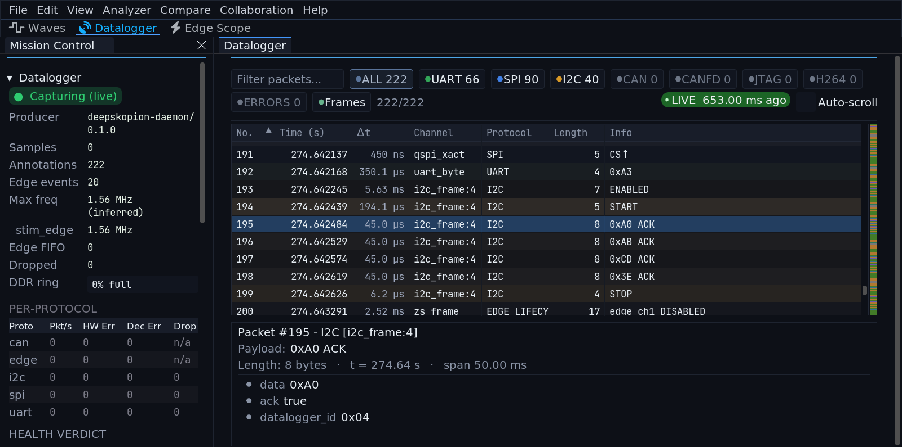
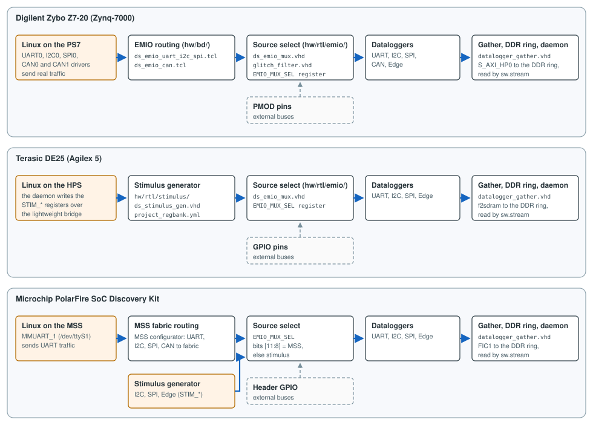
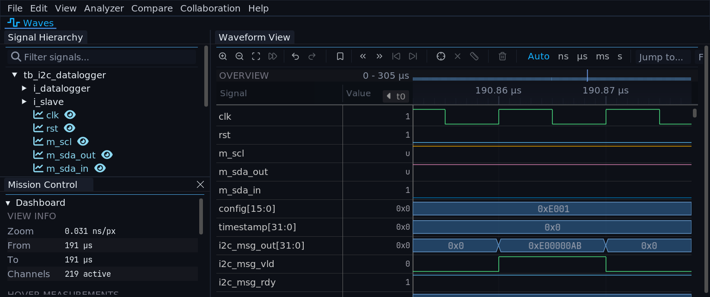

# Deepskopion

Deepskopion is a protocol datalogger that runs on an FPGA SoC development board. It decodes traffic from several buses at once in the FPGA fabric and stamps every record from one hardware counter, so traffic from different buses lines up on one timeline. A Linux daemon on the board streams the records over TCP to a viewer or any other program.

---

## Supported Boards

| Board | Target | Device | Toolchain |
|---|---|---|---|
| Digilent Zybo Z7-20 | [`zybo_datalogger`](targets/zybo_datalogger.yml) | AMD Zynq-7000 `xc7z020clg400-1` | Vivado |
| Terasic DE25 | [`de25_datalogger`](targets/de25_datalogger.yml) | Altera Agilex 5 `A5ED013BB32AE4SCS` | Quartus Prime Pro |
| Microchip PolarFire SoC Discovery Kit | [`pfsoc_datalogger`](targets/pfsoc_datalogger.yml) | Microchip PolarFire SoC `MPFS095T-1FCSG325E` | Libero SoC |

Each board has a build guide in [`docs/getting_started/`](docs/getting_started/README.md): select the board, build the FPGA design, build the Linux image and write it to a card, program the FPGA where the board needs it, then boot and attach RouteWave. [`docs/SUPPORTED_ENVIRONMENT.md`](docs/SUPPORTED_ENVIRONMENT.md) declares the supported host, tools and board, and `tools/preflight/ds_preflight.py` checks them.

---

## Supported Protocols

The data loggers decode these protocols:

* UART
* I2C
* SPI
* QSPI
* JTAG (passive TAP capture)
* CAN
* Edge (timed transitions)

Every data logger has a simulation testbench. On all three boards, the self-test checks the UART, I2C, SPI and edge
data loggers with the board alone ([Self-test](docs/getting_started/self_test.md)). Board-specific limits are in the
[Release Notes](docs/RELEASE_NOTES.md).

---

## Captures

RouteWave 2.7.0 attached live to a Zybo Z7-20 running the 0.1.0 image, with the UART, I2C, SPI and edge self-test
traffic running at the same time. Each byte is decoded in the fabric and stamped from the board's counter; the rows
interleave in time order, and no protocol reports an error.



---

## Architecture


| Block | Function |
|---|---|
| Dataloggers | Tap bus lines, reconstruct frames and add hardware timestamps |
| Arbiter and framer | Merge datalogger messages into `zs_msg` records (`datalogger_gather.vhd`) |
| DDR writer | Writes records to a ring buffer in board DDR through `rr_ddr_stream` |
| Capture daemon | Drains the ring on Linux and streams records over TCP |
| Readers | RouteWave, or any program that reads the stream |

---

## In-System Self-Test

On all three boards, the default targets generate bus traffic for six of the nine data loggers of the default mix, so those loggers capture with the board alone; the other three need external traffic on their header pins. Which logger gets which source: [Self-test](docs/getting_started/self_test.md).



---

## Building the System

The project is built with [RouteRTL](https://routertl.dev) (`rr`): it fetches the IP packages, runs the simulations,
builds the FPGA design and the Linux image, and programs the board.

> RouteRTL is the author's own tool. It installs free from PyPI (`pip install routertl`); its licence terms are on
> [its PyPI page](https://pypi.org/project/routertl/). No step in this README or its guides needs a paid RouteRTL
> feature or licence. The vendor tools (Vivado, Quartus Prime Pro, Libero SoC) carry their own licences.

### Requirements

| Item | Version |
|---|---|
| RouteRTL | `routertl >= 5.7.0` |
| Python | `>= 3.11, < 3.15` |
| RouteWave | `>= 2.4.0`, from its [release page](https://github.com/djmazure/routewave/releases) (see below) |
| Vivado (Zybo Z7-20) | `2024.1`, ML Standard or ML Enterprise |
| Quartus Prime Pro (DE25) | `25.3.1` with patch 1.02, and a licence that covers Agilex 5 E-Series: Quartus offers a no-cost one ([details](docs/SUPPORTED_ENVIRONMENT.md#toolchain)) |
| Libero SoC (PolarFire SoC Discovery Kit) | `2025.2` |
| NVC (simulation only) | `>= 1.19.3` |
| Host | x86_64 Linux, 24 GB RAM as the OS sees it (under WSL2: the `.wslconfig` limit), 60 GB free disk |

Host packages, and fixes for known host problems: [Host setup](docs/getting_started/host_setup.md).

### RouteWave

RouteWave comes from its [release page](https://github.com/djmazure/routewave/releases): `routewave-<version>-windows-x86_64.zip`
for Windows, and `routewave-<version>-linux-x86_64.tar.gz` for Linux. `RouteWave-<version>-x86_64.AppImage` also runs on
Linux where FUSE is available. Each release carries `SHA256SUMS.txt`, its signature and the signing key. On Linux, with
the packages of [Host setup](docs/getting_started/host_setup.md), the tarball is fetched, checked and unpacked in the
home folder with:

```bash
cd ~
VER=2.7.0
base=https://github.com/djmazure/routewave/releases/download/v${VER}
for f in routewave-${VER}-linux-x86_64.tar.gz SHA256SUMS.txt SHA256SUMS.txt.asc PUBLIC_KEY.asc; do curl -fsSLO ${base}/$f; done
sha256sum --check --ignore-missing SHA256SUMS.txt
gpg --import PUBLIC_KEY.asc && gpg --verify SHA256SUMS.txt.asc SHA256SUMS.txt
tar xzf routewave-${VER}-linux-x86_64.tar.gz && ./routewave-${VER}-linux-x86_64/routewave --version
```

`sha256sum` prints `OK` for the tarball, and `gpg --verify` prints `Good signature` and the line
`Primary key fingerprint: B545 F7DE 394B 58A2 65F8  3101 BF17 E0A1 F3D0 9ED1`.

On Windows, in PowerShell, the zip is fetched, checked and unpacked in the Downloads folder with the block below. It
calls `curl.exe`: in PowerShell, `curl` names another command.

```powershell
Set-Location "$HOME\Downloads"
$VER = "2.7.0"
$base = "https://github.com/djmazure/routewave/releases/download/v$VER"
curl.exe -fsSLO "$base/routewave-$VER-windows-x86_64.zip"
curl.exe -fsSLO "$base/SHA256SUMS.txt"
(Get-FileHash "routewave-$VER-windows-x86_64.zip").Hash
Select-String -Path SHA256SUMS.txt -Pattern "windows-x86_64.zip"
Expand-Archive "routewave-$VER-windows-x86_64.zip" -DestinationPath .
```

The two hashes printed are the same (`Get-FileHash` prints it in upper case). RouteWave is then
`routewave-<version>-windows-x86_64\routewave.exe`.

### Simulation

The blocks of the design have their own testbenches: each data logger, the stimulus generators, and the gather that
merges the data loggers' records. They run in the free NVC simulator, with no board and no vendor tool. They run in a
git clone (a simulation hook reads the clone's commit; an unpacked archive views the shipped capture but does not
simulate), with RouteRTL installed and the repository cloned as in
[Host setup](docs/getting_started/host_setup.md#install-routertl-and-clone-the-repository).

`rr eda install nvc` builds NVC through the system package manager and asks for `sudo`; a host that already has
NVC 1.19.3 or newer on `PATH` leaves that line out. `rr pkg install` fetches the IP packages `ip.lock` pins and records
them for the active target (the repository's default target, the DE25) under `.routertl_cache/`.

```bash
rr eda install nvc
rr pkg install
pip install -r requirements.txt
rr sim list
rr sim run test_i2c_datalogger
```

`rr sim list` lists every testbench and the command that runs it (excerpt):

```text
MODULE                              LOCATION                                           DISCOVERY STATUS   COMMAND
test_i2c_datalogger                 cocotb/tests/datalogger/i2c/test_i2c_datalogger.py OK                 rr sim run test_i2c_datalogger
test_uart_datalogger                cocotb/tests/datalogger/uart/test_uart_datalogger.py OK                 rr sim run test_uart_datalogger
test_can_frame_fsm                  cocotb/tests/datalogger/can/test_can_frame_fsm.py  OK                 rr sim run test_can_frame_fsm
test_datalogger_gather              cocotb/tests/datalogger/infra/datalogger_gather/test_datalogger_gather.py OK                 rr sim run test_datalogger_gather
...
```

Each test writes an FST waveform to `hw/sim/waves/<test>/`, which RouteWave opens:


### View a capture without building anything

The repository ships one capture, `docs/captures/i2c_write_transaction.fst` (6.2 kB): the waveform of the I2C data
logger testbench's write-transaction test, under the same CERN-OHL-W-2.0 licence as the rest of the design. It opens
in [RouteWave](#routewave) on Linux and Windows, with no simulator, vendor tool or board. The command runs in the
DeepSkopion folder (the clone, or the unpacked archive): the capture path is relative to it. An archive downloaded from
GitHub unpacks with `unzip deepskopion-main.zip` on Linux or `Expand-Archive deepskopion-main.zip` in PowerShell (about
half a minute). `RW` is the RouteWave program unpacked above:

```bash
RW=~/routewave-2.7.0-linux-x86_64/routewave
"$RW" -c "open docs/captures/i2c_write_transaction.fst; wait 3000; show --tree tb_i2c_datalogger; zoom 190.852us 190.878us"
```

On Windows, in PowerShell:

```powershell
$RW = "$HOME\Downloads\routewave-2.7.0-windows-x86_64\routewave.exe"
& $RW -c "open docs/captures/i2c_write_transaction.fst; wait 3000; show --tree tb_i2c_datalogger; zoom 190.852us 190.878us"
```

`wait 3000` lets the file finish loading before `show` runs: RouteWave 2.7.0 runs the next command before the load
ends. The view ends on one message of the data logger, `0xE00000AB`, while `i2c_msg_vld` is high. RouteWave reporting
`Load finished … (failed)` means the command did not run in the DeepSkopion folder. The command opens a RouteWave
window that stays open until it is closed; RouteWave's messages, such as `Loaded … channels`, appear in its console
panel, not in the terminal.



### Build and run on a board

RouteRTL installed and the repository cloned as in [Host setup](docs/getting_started/host_setup.md#install-routertl-and-clone-the-repository), then the board's guide:

| Board | Guide |
|---|---|
| Digilent Zybo Z7-20 | [Build and run on the Zybo Z7-20](docs/getting_started/zybo_z7_20.md) |
| Terasic DE25 | [Build and run on the Terasic DE25](docs/getting_started/de25.md) |
| Microchip PolarFire SoC Discovery Kit | [Build and run on the PolarFire SoC Discovery Kit](docs/getting_started/polarfire_soc_discovery.md) |

The serial console, the network address and SSH at the first boot: [First boot](docs/getting_started/first_boot.md).

---

## Data Logger Combination

Deepskopion builds the combination of data loggers the user selects. The configurator
([`tools/datalogger-builder/configurator.py`](tools/datalogger-builder/README.md)) writes the combination to a YAML file
and checks it against the board: its free header pins, and at most 31 data loggers in one design. For example, two
UART, two I2C, one SPI and four edge data loggers on the Zybo Z7-20:

```bash
python3 tools/datalogger-builder/configurator.py --board zybo-z7-20 \
    --uart 2 --i2c 2 --spi 1 --edge 4 -o tools/datalogger-builder/config/my_mix.yml
```

Building a target from it, and the combinations that ship: [Data logger combination](docs/getting_started/datalogger_mix.md).

---

## Building Linux and the Capture Daemon

Each board guide builds the Linux image with `rr linux`, with the capture daemon in it. The daemon runs on Linux on the processor subsystem of each board: the Zynq PS (Arm), the Agilex HPS (Arm) or the PolarFire SoC MSS (RISC-V).

| Item | Value |
|---|---|
| Stream port | TCP `7475` |
| Stream format | `wave_stream_v1`, MessagePack framing, defined in [`contracts/wave_stream_v1/README.md`](contracts/wave_stream_v1/README.md) |
| Event port | TCP `7476`, `wave_events_v1` ([`docs/DEPLOYMENT_CONTRACT.md`](docs/DEPLOYMENT_CONTRACT.md)) |
| Software documentation | [`docs/software/README.md`](docs/software/README.md) |

The telemetry exporter (`sw/telemetry`) reports CPU load, memory use and interrupt rates as JSON. Its kernel-error
reading (from `/dev/kmsg`) is measured on the Zybo Z7-20, where a warning-level record written to `/dev/kmsg` is counted;
it is not measured on the DE25 or the PolarFire SoC Discovery Kit. Its temperature reading is not measured on any board. It is in no board image and does
not start at boot; [`docs/software/telemetry_exporter.md`](docs/software/telemetry_exporter.md) describes how to copy
it to each board and run it.

---

## Reading the Stream

RouteWave is one client of the versioned `wave_stream_v1` contract. Any program that reads MessagePack can attach to port 7475; [Reading the stream](docs/getting_started/reading_the_stream.md) has a 20-line Python client and its output. The frame tags, payload fields and channel IDs are defined in [`contracts/wave_stream_v1/README.md`](contracts/wave_stream_v1/README.md).

---

## Documentation Index

### Getting Started
* [Getting started](docs/getting_started/README.md): Host setup, the three board guides, first boot, self-test, data logger combination and a stream client.

### System Architecture
* [System Overview](docs/SYSTEM_OVERVIEW.md): Architecture, data plane flow and DDR buffer model.
* [FPGA Design](docs/hardware/fpga_design.md): Datalogger subsystems, clock domains and FIFOs.
* [Software Architecture](docs/software/README.md): Capture daemon, ring draining and kernel interfaces.
* [Deployment Contract](docs/DEPLOYMENT_CONTRACT.md): How software reaches a board.
* [Supported Environment](docs/SUPPORTED_ENVIRONMENT.md): Host OS, tools and memory requirements.
* [Redistribution](docs/REDISTRIBUTION.md): Third-party and vendor-generated files.
* [Release Notes](docs/RELEASE_NOTES.md): Targets, default mix, requirements and known limitations of each release.

### Datalogger Specifications
* [Protocol Dataloggers Overview](hw/rtl/datalogger/README.md): Subsystem status and directory map.
* [UART Datalogger Protocol](hw/rtl/datalogger/uart/UART_DATALOGGER_PROTOCOL.md): Wire framing and error status.
* [I2C Datalogger Protocol](hw/rtl/datalogger/i2c/I2C_DATALOGGER_PROTOCOL.md): Bus events and byte messages.
* [QSPI Datalogger Protocol](hw/rtl/datalogger/qspi/QSPI_DATALOGGER_PROTOCOL.md): Flash transactions and command decoding.
* [Edge Datalogger Protocol](hw/rtl/datalogger/nonstd/edge_datalogger/EDGE_DATALOGGER_PROTOCOL.md): Transition timestamps and batch format.
* [Level Datalogger Protocol](hw/rtl/datalogger/nonstd/level_datalogger/LEVEL_DATALOGGER_PROTOCOL.md): Level samples.

The SPI, CAN and JTAG dataloggers have no protocol document yet. The CAN and JTAG record fields are declared in
[`can_datalogger_protocol.yml`](hw/rtl/datalogger/can/can_datalogger_protocol.yml) and
[`jtag_datalogger_protocol.yml`](hw/rtl/datalogger/jtag/jtag_datalogger_protocol.yml).

---

## Contributing

Contributions are welcome. [`CONTRIBUTING.md`](CONTRIBUTING.md) has the full workflow.

* Commits of outside contributions carry a `Signed-off-by:` line under the Developer Certificate of Origin (`git commit -s`).
* A pull request that changes RTL, the daemon, a device tree or a target needs a clean simulation regression and, on the DE25, a record from `rr hw run <REQ_ID> --probe juart --write`. The hardware runs in [`runtimes/hw.yml`](runtimes/hw.yml) are declared for the DE25 only.
* New board targets and new protocol dataloggers are welcome, for example an Efinix Ti60 port with the Sapphire RISC-V SoC, a Zynq UltraScale+ port, or an EtherCAT datalogger.
* Every `.py`, `.vhd`, `.c`, `.h`, `.v` and `.sv` file and every shell script written with AI carries an `rr <model> (AI-generated)` comment as its first line after any `#!` line and Python encoding line (`unknown-llm` where the model is not recorded); vendored files, tool-generated files, frozen evidence records whose hashes are quoted, and the exceptions listed in [`AI_PROVENANCE_EXCEPTIONS.txt`](AI_PROVENANCE_EXCEPTIONS.txt) do not. `tools/ai_provenance_stamp.py --write` adds it to a new file.

---

## Licensing Summary

| Component | Path | License |
|---|---|---|
| Gateware and RTL | `hw/`, `sim/`, `docs/` | [CERN-OHL-W-2.0](LICENSES/CERN-OHL-W-2.0.txt) |
| Software | `sw/`, `tools/`, `contracts/` | [MPL-2.0](LICENSES/MPL-2.0.txt) |
| IP packages | `libs/` | Each package's own license; `rr pkg install` fetches them at the commits `ip.lock` pins |

Both licenses are weakly reciprocal at the file level. Deepskopion components can go into a larger design or a commercial product, and the rest of that design keeps its own licence. Changes to Deepskopion files stay under their licenses. See [`LICENSE.md`](LICENSE.md), [`REUSE.toml`](REUSE.toml) and [`ATTRIBUTIONS.md`](ATTRIBUTIONS.md).
