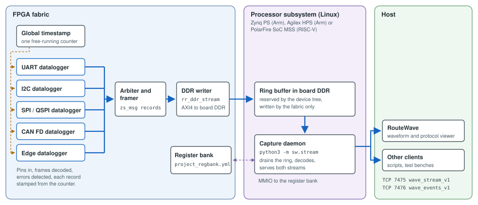
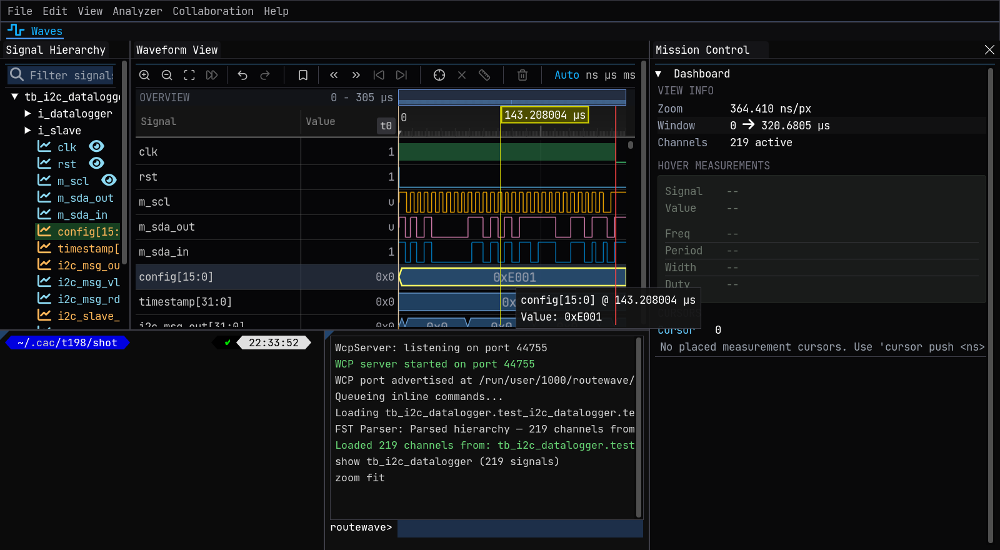

# Deepskopion

Deepskopion is a protocol datalogger that runs on an FPGA SoC development board. It decodes traffic from several buses at once in the FPGA fabric and stamps every record from one hardware counter, so traffic from different buses lines up on one timeline. A Linux daemon on the board streams the records over TCP to a viewer or any other program.

---

## Supported Boards

| Board | Target | Device | Toolchain |
|---|---|---|---|
| Digilent Zybo Z7-20 | [`zybo_datalogger`](targets/zybo_datalogger.yml) | AMD Zynq-7000 `xc7z020clg400-1` | Vivado |
| Terasic DE25 | [`de25_datalogger`](targets/de25_datalogger.yml) | Altera Agilex 5 `A5ED013BB32AE4SCS` | Quartus Prime Pro |
| Microchip PolarFire SoC Discovery Kit | [`pfsoc_datalogger`](targets/pfsoc_datalogger.yml) | Microchip PolarFire SoC `MPFS095T-1FCSG325E` | Libero SoC |

Each board has its own build section below, after a common setup: select the board, build the FPGA design, build the Linux image and write it to a card, program the FPGA where the board needs it, then boot and attach RouteWave. [`docs/SUPPORTED_ENVIRONMENT.md`](docs/SUPPORTED_ENVIRONMENT.md) declares the supported host, tools and board, and `tools/preflight/ds_preflight.py` checks them.

On the PolarFire SoC Discovery Kit a complete board self-test has not yet passed; the kit boots Linux and runs the capture daemon. Its MSS component is generated locally from the committed configuration ([`hw/libero/pfsoc/mss/README.md`](hw/libero/pfsoc/mss/README.md)). Some cold boots of the kit do not reach the Linux shell: one recorded stop is after DDR training, in the SD-card start-up of its boot firmware (the Hart Software Services), which also occurs with Microchip's reference design.

---

## Supported Protocols

| Protocol | Records | Status |
|---|---|---|
| UART | Baud rate calibration, frames, parity and framing errors | Default targets |
| I2C | START and STOP, 7-bit address, ACK and NACK, data bytes | Default targets |
| SPI | Chip-select framing, MOSI and MISO bytes | Default targets |
| QSPI | Flash command, address and data | Selected with the configurator on the Zybo Z7-20 and the DE25; the configurator refuses it for the PolarFire SoC Discovery Kit, which has no measured resource cost for it yet |
| JTAG | Passive TAP capture | Selected with the configurator; records no live traffic on the DE25 and the PolarFire SoC Discovery Kit, whose tops tie the tap it reads to constants |
| Edge | Timed transitions, batched | Default targets |
| CAN | IDs, DLC, CRC and stuff errors | Default targets; see [CAN licensing](#appendix-can-fd-licensing) |

---

## When Another Tool Fits

Deepskopion decodes protocols inside a running FPGA SoC. RouteWave exports a live or recorded capture as a sigrok
session (`.sr`) with a PulseView setup (`.pvs`), through File > Export or `routewave_cli export-sr`, so a capture opens in
[PulseView](https://sigrok.org/) as well.

Another tool fits analog signals, and board bring-up before Linux runs: a mixed-signal oscilloscope.

See [`ATTRIBUTIONS.md`](ATTRIBUTIONS.md).

---

## Architecture



| Block | Function |
|---|---|
| Dataloggers | Tap bus lines, reconstruct frames and add hardware timestamps |
| Arbiter and framer | Merge datalogger messages into `zs_msg` records (`datalogger_gather.vhd`) |
| DDR writer | Writes records to a ring buffer in board DDR through `rr_ddr_stream` |
| Capture daemon | Drains the ring on Linux and streams records over TCP |
| Readers | RouteWave, or any program that reads the stream |

---

## In-System Self-Test

On the Zybo Z7-20, the DE25 and the PolarFire SoC Discovery Kit, the default targets generate bus traffic for six of the nine data loggers of the default mix, so those loggers capture with the board alone. The other three need external traffic on their header pins. The reach is the same on all three boards; it is measured in simulation by [`test_selftest_coverage.py`](hw/sim/cocotb/tests/datalogger/infra/default_mix/test_selftest_coverage.py). On the PolarFire SoC Discovery Kit a complete board self-test has not yet passed.

| Data logger | Board-alone source |
|---|---|
| Edge 1 | The edge stimulus, or the I2C or SPI edge route; on the Zybo Z7-20 also the CAN edge route, and on the PolarFire SoC Discovery Kit also the UART edge route |
| Edge 2 | The I2C or SPI edge route |
| Edge 3 | The SPI edge route: the on-chip SPI responder (spi_injector) answers each byte of the SPI stimulus on MISO |
| I2C 4 | The I2C stimulus |
| I2C 5 | None: external traffic only |
| SPI 8 | The SPI stimulus |
| UART 12 | The UART stimulus (on the PolarFire SoC Discovery Kit, MMUART_1) |
| UART 13 | None: external traffic only |
| CAN 20 | None: external traffic only. The SPI edge route also drives this input with the SPI chip-select, which is not CAN traffic. |

The SPI edge route reaches Edge 1, Edge 2 and Edge 3 when it is requested together with the SPI stimulus, which writes the route before the first byte:

```bash
BOARD_IP=board-ip   # the board's address
python3 -m sw.stream.testbench.live_capture_client --host "$BOARD_IP" --stim spi --edge-route spi
```


| Board | Traffic source | Sources |
|---|---|---|
| Zybo Z7-20 | The stimulus block in the fabric drives the EMIO input lines while a protocol's `STIM_*_CONTROL` enable bit is set; otherwise the Linux drivers on the PS peripherals drive them over EMIO. The `EMIO_MUX_SEL` register selects the input. | [`hw/bd/ds_emio_uart_i2c_spi.tcl`](hw/bd/ds_emio_uart_i2c_spi.tcl), [`hw/bd/ds_emio_can.tcl`](hw/bd/ds_emio_can.tcl), [`hw/rtl/emio/ds_emio_mux.vhd`](hw/rtl/emio/ds_emio_mux.vhd), [`hw/rtl/emio/glitch_filter.vhd`](hw/rtl/emio/glitch_filter.vhd), [`hw/rtl/stimulus/ds_stimulus_gen.vhd`](hw/rtl/stimulus/ds_stimulus_gen.vhd) |
| DE25 | A stimulus block in the fabric, controlled from Linux through the `STIM_*` registers. | [`hw/rtl/stimulus/ds_stimulus_gen.vhd`](hw/rtl/stimulus/ds_stimulus_gen.vhd), [`project_regbank.yml`](project_regbank.yml) |
| PolarFire SoC Discovery Kit | Linux writes UART traffic on MMUART_1 (`/dev/ttyS1`), which the MSS routes to the fabric. `EMIO_MUX_SEL` bits [11:8] select the MSS I2C, UART, SPI and CAN; this image arms the UART bit only. I2C, SPI and edge traffic come from the fabric stimulus block through the `STIM_*` registers. | [`hw/rtl/pfsoc/deepskopion_pfsoc_top.vhd`](hw/rtl/pfsoc/deepskopion_pfsoc_top.vhd), [`hw/libero/pfsoc/pfsoc_mss_subsys.tcl`](hw/libero/pfsoc/pfsoc_mss_subsys.tcl), [`hw/rtl/stimulus/ds_stimulus_gen.vhd`](hw/rtl/stimulus/ds_stimulus_gen.vhd) |


---

## Build This with RouteRTL

Deepskopion uses the [RouteRTL](https://routertl.dev) build system (`rr`) to manage IP dependencies, run VHDL simulations, build bitstreams and program boards.

> Disclosure: RouteRTL is the author's own tool, written by the same person as Deepskopion.
> `rr` installs free from PyPI (`pip install routertl`). Its CLI and build system are MIT-licensed. Its compiled core is under
> the RouteRTL Core License 1.0: an evaluation period, then free for registered individuals and for open-hardware
> projects whose sources are published under an open license, and a commercial licence for organisations. The terms are
> in the Licensing table of RouteRTL's README, shown on [its PyPI page](https://pypi.org/project/routertl/).
> Within those terms, no command in this README requires a paid licence, and none uses RouteRTL's paid features
> (`rr loop`, `rr formal`, `rr verify`, coverage). On a fresh, unregistered RouteRTL 5.7.0 install, the simulation in
> [Try it without a board](#try-it-without-a-board) runs to the end.
> That covers RouteRTL only: the vendor tools in Requirements (Vivado, Quartus Prime Pro, Libero SoC) carry their own licences.
> Deepskopion itself is open hardware and software; see [Licensing Summary](#licensing-summary).

### Requirements

| Item | Version |
|---|---|
| RouteRTL | `routertl >= 5.7.0` |
| Python | `>= 3.11, < 3.15` |
| RouteWave | `>= 2.4.0` |
| Vivado (Zybo Z7-20) | `2024.1`, ML Standard or ML Enterprise |
| Quartus Prime Pro (DE25) | `25.3.1` with patch 1.02, and a licence that covers Agilex 5 |
| Libero SoC (PolarFire SoC Discovery Kit) | `2025.2` |
| NVC (simulation only) | `>= 1.19.3` |
| Host | x86_64 Linux, 24 GB RAM as the OS sees it (under WSL2: the `.wslconfig` limit), 60 GB free disk |

### Python 3.11 on Ubuntu 22.04

RouteRTL needs Python 3.11 or newer. On Ubuntu 24.04, `python3` is 3.12 and the quick starts below run as written. On
Ubuntu 22.04, `python3` is 3.10 and the distribution has no released Python 3.11 package, so these three commands
replace each quick start's `python3 -m venv .venv` line. They install a user-local Python 3.11 through uv and need no
sudo:

```bash
python3 -m venv .uv && .uv/bin/pip install uv
.uv/bin/uv python install 3.11
.uv/bin/uv venv --seed --python 3.11 .venv
```

`--seed` puts pip into the environment, so the following `pip install` lines install into Python 3.11.

### Try it without a board

The datalogger RTL runs in simulation on an x86_64 Linux host with Python, RouteRTL and the free NVC simulator. No board, vendor tool or licence is needed.

```bash
python3 -m venv .venv          # Ubuntu 22.04: the three commands of "Python 3.11 on Ubuntu 22.04" instead
source .venv/bin/activate
pip install routertl
git clone https://github.com/routertl/deepskopion.git deepskopion
cd deepskopion
rr eda install nvc
rr pkg install
pip install -r requirements.txt
rr sim run test_i2c_datalogger
```

`rr eda install nvc` builds NVC from source with the system package manager; on a fresh container image, `apt-get update` comes first. The run drives an I2C bus model into the I2C datalogger and checks the messages it emits: nine tests, about 36 seconds of simulation. Each test writes an FST waveform to `hw/sim/waves/test_i2c_datalogger/`, which RouteWave opens:

```bash
routewave -c "open hw/sim/waves/test_i2c_datalogger/tb_i2c_datalogger.test_i2c_datalogger.test_write_transaction.fst; show --tree tb_i2c_datalogger; zoom fit"
```



The other datalogger testbenches run the same way; `rr sim run --all` runs every test.

### Install RouteRTL and clone the repository

Each board's build below starts from this, in the same shell:

```bash
python3 -m venv .venv          # Ubuntu 22.04: the three commands of "Python 3.11 on Ubuntu 22.04" instead
source .venv/bin/activate
pip install routertl
git clone https://github.com/routertl/deepskopion.git deepskopion
cd deepskopion
```

### Build and run on the Zybo Z7-20

The build runs Vivado 2024.1, so put it on `PATH` and set `XILINX_VIVADO` first, in the shell that runs the steps below. After a standard install, the installer's script does both:

```bash
INSTALL_DIR=/path/to/xilinx-install   # the directory Vivado was installed into
source "$INSTALL_DIR/Vivado/2024.1/settings64.sh"
```

An install copied to another directory, rather than installed there, keeps the original directory inside `settings64.sh`, so that script points at the wrong place. Set the two variables directly instead; no vendor file needs editing:

```bash
INSTALL_DIR=/path/to/vivado-copy   # the directory the install was copied to
export XILINX_VIVADO="$INSTALL_DIR/Vivado/2024.1"
export PATH="$XILINX_VIVADO/bin:$PATH"
```

`vivado -version` then prints `vivado v2024.1`, and step 2 checks the same version. RouteRTL finds the pinned 2024.1 release through `XILINX_VIVADO`.

```bash
# 1. Select the board, then fetch the packages its committed lock names
rr target set zybo_datalogger
rr pkg install
pip install -r requirements.txt

# 2. Check the host against the supported environment
python3 tools/preflight/ds_preflight.py --stage build

# 3. Build the bitstream (step 4 needs it)
rr synth run
rr implementation run
rr bitstream run

# 4. Build the Linux image, which embeds the bitstream, and write it to a microSD card.
#    It needs step 3's implementation: without it, the Linux build stops with
#    "Implementation checkpoint not found".
#    The Python runtime of the image is built once from upstream Buildroot (1-3 h).
#    CARD is the card's boot (FAT) partition in the host reader, for example /dev/sdb1.
sw/linux/build_buildroot.sh && sw/linux/extract_python_overlay.sh
rr linux tools install
rr linux build
CARD=/dev/sdX1
rr linux flash-sd --device "$CARD"

# 5. Boot the board from the card with Ethernet connected, then attach RouteWave.
#    BOARD_IP is the address the board takes at first boot (see First boot).
BOARD_IP=board-ip
routewave -c "stream attach $BOARD_IP:7475"
```

Host requirements of step 4, on Ubuntu and Debian:

- Buildroot's own dependency check (`support/dependencies/dependencies.sh` of the pinned release) requires these programs on the host: `make`, `gcc`, `g++`, `bash`, `git`, `patch`, `perl`, `tar`, `wget`, `cpio`, `unzip`, `rsync`, `bc`, `cmp`, `find`, `xargs`, `which`, `sed` and `file`. A stock Ubuntu 24.04 install lacks some of them (`cpio` was missing on a WSL host). One line installs all of them:

  ```bash
  sudo apt-get install build-essential cpio unzip rsync bc wget file patch perl git diffutils findutils
  ```

  Buildroot builds the other host tools it needs (`bison`, `flex`, `dtc`, `pkg-config`, OpenSSL) itself, so none of them is a host requirement of `build_buildroot.sh`.
- `rr linux tools status` lists the tools `rr linux build` needs on the host: the ARM cross-compiler (`arm-linux-gnueabihf-gcc`), `mkimage`, `dtc` and the kernel build packages. `rr linux tools install` installs the missing ones (it uses `sudo apt-get`). Without them, `rr linux build` stops while compiling BusyBox with `arm-linux-gnueabihf-gcc: command not found`.
- WSL: a default WSL install appends the Windows `PATH` to the Linux one, and entries such as `/mnt/c/Program Files/...` contain a space. Buildroot refuses a `PATH` with a space and stops within seconds with `Your PATH contains spaces, TABs, and/or newline characters`. This line removes the entries with whitespace from the `PATH` of the current shell; a new shell restores them:

  ```bash
  export PATH="$(printf '%s' "$PATH" | tr ':' '\n' | grep -v '[[:space:]]' | paste -sd:)"
  ```

  It runs before `sw/linux/build_buildroot.sh`. Vivado, put on the `PATH` earlier for step 3, is not needed by step 4 itself; if its install directory contains a space, the line removes it from the `PATH` and the `XILINX_VIVADO` variable still locates it.

The implementation step checks the routed design's resource use against the ceilings in `requirements.yml`. If
`rr implementation run` fails that check right after a new `rr synth run` and its log shows `CACHE HIT`, the check
may have read the synthesis figures, which are higher before optimisation, instead of the routed ones.
`rr implementation run --force` runs place and route again and gives a fresh verdict on the routed design.

RouteWave shows edge records in its Edge Scope. `stream status --json` in the RouteWave console reports the connection state.

In the RouteWave console, `export <file.vcd>` saves the session, and `open <file>` opens a saved capture (VCD, FST or ltrace).

The bitstream reaches the fabric from the card at boot, so a new bitstream goes to the board in a new card image.

### First boot

The Zybo Z7-20 and PolarFire SoC images ship with no network address and no SSH key. The board's USB serial console
(115200 8N1) is available from power-on and takes these steps, in this order:

1. Address. A static address is used first, from the first of these sources that is set:
   - `ds_ip=<address>/<prefix>` (and optionally `ds_gateway=<gateway>`) on the kernel command line;
   - `/etc/deepskopion/network.conf` with the line `address=<address>/<prefix>` (and optionally `gateway=<gateway>`),
     applied by `/etc/init.d/S40network restart`. On the Zybo Z7-20 the root filesystem is held in RAM, so a file
     written on the board lasts until the next boot; the same file placed as `etc/deepskopion/network.conf` under the
     rootfs overlay directory `sw/linux/rootfs_overlay/` before the image build is part of the image. On the PolarFire
     SoC Discovery Kit the root filesystem is the card's third partition, mounted read-write, so a file written on the
     kit persists across boots.

   Without a static address the board requests one over DHCP. Without a DHCP server it boots with no address and
   prints `network: no DHCP lease; set ds_ip=<address>/<prefix> or create /etc/deepskopion/network.conf`.

   RouteWave needs only the address: the stream on port 7475 does not use SSH.
2. SSH key. SSH stays off until an owner key exists, and password logins are disabled. `deepskopion-authorize-key
   /path/to/key.pub` on the serial console installs a public key (`deepskopion-authorize-key -` reads it from standard
   input). A key file placed as `etc/deepskopion/authorized_keys` under `sw/linux/rootfs_overlay/` (ignored by git)
   before the build is installed at every boot instead; it becomes `/etc/deepskopion/authorized_keys` in the image.
3. SSH start. `/etc/init.d/S49dropbear start` starts the SSH server.

The DE25 image differs: it ships with the static address of its deployment descriptor on its kernel command line and
no SSH server ([Build and run on the Terasic DE25](#build-and-run-on-the-terasic-de25)).

[`docs/SUPPORTED_ENVIRONMENT.md`](docs/SUPPORTED_ENVIRONMENT.md) has the details.

### Build and run on the Terasic DE25

RouteRTL installed in a Python 3.11 virtual environment, that environment active, and the clone as the current
directory, as in [Install RouteRTL and clone the repository](#install-routertl-and-clone-the-repository).

Preconditions:

| Item | Required value |
|---|---|
| Quartus Prime Pro | 25.3.1 with patch 1.02 (without the patch it stops with Error 22912), and a licence that covers Agilex 5. Installed at `/opt/altera_pro/25.3`, the path the target names, or elsewhere with its `quartus/bin` and `quartus/sopc_builder/bin` directories on `PATH`; `command -v quartus_sh qsys-generate quartus_pfg` then prints all three. |
| Linux host tools | `rr install linux` (with sudo: u-boot-tools, the device-tree compiler, the kernel build dependencies and the cross compilers; `rr install linux --check` lists them), and the Ubuntu packages `python3-dev`, `mtools`, `fdisk` and `e2fsprogs`. Step 3 installs the swig and setuptools releases U-Boot's build needs into the virtual environment. |
| Deployment descriptor | `runtimes/hw.local.yml` (ignored by git), copied from `runtimes/hw.example.yml`. The image build reads the file named by `RR_BENCH_CONFIG` when that variable is set, and `runtimes/hw.local.yml` otherwise. In that file, `bench.targets.de25_bench.bench_ip` names the resource that holds the board's static address, `de25_address` in the template; that resource's `addr`, and `prefix` as a number (delete the `prefix` line for 24), are the values to set. The image build refuses the template's placeholders and a missing file. |
| Card access | the build user can open the card's block device: a member of the `disk` group, or a udev ACL on the card reader |
| JTAG | the board's on-board USB-Blaster III, connected to the build host as its only JTAG cable (with more than one, `rr program run` needs `--cable`) |
| Serial console | HPS UART1 (`ttyS1` on the board), on the USB-Blaster III's USB serial port, at 115200 8N1 with DTR and RTS asserted; with either line deasserted the port reads nothing |
| Ethernet | the board's HPS Ethernet port on the build host's IPv4 subnet: the image sets the address from step 6 and no default route |
| microSD card | at least 1 GB, in a card reader on the build host |

Each block runs on its own, pasted alone and not joined to another with `&&` or `;`. A block in parentheses runs in a
subshell that stops at the first failing command and returns its status. A block runs only after the previous one
returned 0.

```bash
# 1-5. Select the board, install its packages and Python requirements (the second file pins swig and
#      setuptools for U-Boot's build), check the host, build the FPGA design
( set -e
  rr target set de25_datalogger
  rr pkg install
  pip install -r requirements.txt
  pip install -r tools/de25_uboot_host_requirements.txt
  python3 tools/preflight/ds_preflight.py --stage build
  rr synth run
  rr implementation run
  rr bitstream run )
```

```bash
# 6. Create the deployment descriptor; an existing one is kept
[ -e runtimes/hw.local.yml ] || cp runtimes/hw.example.yml runtimes/hw.local.yml
```

Set `addr` (and `prefix`, or delete it) under `bench.resources.de25_address` in `runtimes/hw.local.yml` before the
next block.
The image build reads the file `RR_BENCH_CONFIG` names when it is set, and `runtimes/hw.local.yml`
otherwise. In that file, `addr` and `prefix` are set under the `bench.resources` entry that
`bench.targets.de25_bench.bench_ip` names; in a copy of the template that entry is `de25_address`.

```bash
# 7. Build the boot chain, kernel, root file system and the card image (it needs step 5's bitstream)
python3 tools/de25_linux_image.py build
```

```bash
# 8. Write the whole card image. CARD is the whole card (`lsblk` lists it as TYPE disk), with none of its
#    partitions mounted. The command shows the card, asks for its serial (or its kernel name when it reports
#    none) before it erases anything, refuses a mounted or non-removable disk, and reads the card back.
( set -e
  CARD=/dev/sdX
  rr linux flash-sd --image --device "$CARD" )
```

Put the card in the board and power it on. The board starts Linux from the card only after step 9, at every
power-on. Step 9 runs once per power-on: before it is repeated, the board is powered off and on again.

```bash
# 9. Program the FPGA and its first-stage boot loader over JTAG, under a lease on the board
rr lease run de25-standard -- rr program run -b sw/linux/de25/out/de25_datalogger/de25_datalogger_hps.sof
```

```bash
# 10. Wait until the daemon listens at the address from step 6 (at most 3 minutes), then attach RouteWave.
#     The serial console prints "network: eth0 uses user-supplied static address" on the way.
#     BOARD_IP is the addr from step 6. This block can be repeated.
( set -e
  BOARD_IP=board-ip
  python3 tools/wait_for_port.py "$BOARD_IP" 7475 --timeout 180
  routewave -c "stream attach $BOARD_IP:7475" )
```

The board takes the address from step 6 at every boot and does not use DHCP. The DE25 image has no SSH server, so
steps 2 and 3 of [First boot](#first-boot) do not apply to it; the serial console and the stream on port 7475 do not
need one. A DE25 rootfs built with `rr linux rootfs` was read with debugfs (image sha256
`14d16638fa751228a9e1df229b1bd4d23a62f3c7caaa5f898c4d79220f1aff87`): it holds no dropbear init script, no key tool and
no dropbear binary. The root file system is on the card's second partition and is mounted read-write, so a file written on the
board persists across boots.

The build preflight judges the selected target: for the DE25 and the PolarFire SoC Discovery Kit it checks the part, the platform, the pinned tool release and the device-tree nodes, and leaves finding the Quartus Prime Pro or Libero SoC install to RouteRTL at build time. [`docs/DEPLOYMENT_CONTRACT.md`](docs/DEPLOYMENT_CONTRACT.md) describes how software reaches each board.

### Build and run on the PolarFire SoC Discovery Kit

RouteRTL installed in a Python 3.11 virtual environment, that environment active, and the clone as the current
directory, as in [Install RouteRTL and clone the repository](#install-routertl-and-clone-the-repository).

Preconditions:

| Item | Required value |
|---|---|
| Libero SoC | 2025.2, with a licence that covers the MPFS095T |
| Kit eNVM | the Hart Software Services (HSS) of Microchip's `polarfire-soc-discovery-kit-reference-design`, programmed once with that release's FlashPro Express job. The DeepSkopion build does not write the eNVM. |
| microSD card | at least 1 GB, in a card reader on the build host |

```bash
# 1-2. Select the board, fetch its packages, and check the host against the supported environment
rr target set pfsoc_datalogger
rr pkg install
pip install -r requirements.txt
python3 tools/preflight/ds_preflight.py --stage build

# 3. Build the FPGA design (Libero SoC); the result is a FlashPro Express job
rr synth run
rr implementation run
rr bitstream run

# 4. Program the fabric and its design-initialisation data over the kit's embedded FlashPro5,
#    under a lease on the kit (RouteRTL refuses a hardware command without one)
rr lease run polarfire-soc-discovery -- rr program run

# 5. Build the riscv64 Python runtime of the image once from upstream Buildroot (1-3 h)
sw/linux/pfsoc/build_python_overlay.sh

# 6. Build the boot chain, kernel, root file system and the card image
rr linux build

# 7. Write the whole card image. CARD is the whole card (`lsblk` lists it as TYPE disk), with none of its
#    partitions mounted. The command shows the card, asks for its serial (or its kernel name when it reports
#    none) before it erases anything, refuses a mounted or non-removable disk, and reads the card back.
CARD=/dev/sdX
rr linux flash-sd --image --device "$CARD"

# 8. Put the card in the kit (J17), power it on, then attach RouteWave.
#    BOARD_IP is the address the kit takes at first boot (see First boot).
BOARD_IP=board-ip
routewave -c "stream attach $BOARD_IP:7475"
```

The fabric stays programmed across power cycles; step 4 is repeated only for a new FPGA build. The card holds the
kernel, the root file system and the capture daemon. The first boot follows "First boot" above.

---

## Choosing a Datalogger Mix

The set of dataloggers in a build is declared in a YAML file, which the target names in `system_config`. [`tools/datalogger-builder/configurator.py`](tools/datalogger-builder/README.md) writes that file, checks the mix against the board's pin and ID limits, estimates resource use, and prints which board pin carries each signal.

```bash
# 1. Write the mix
python3 tools/datalogger-builder/configurator.py \
    --board zybo-z7-20 \
    --uart 2 --i2c 2 --spi 1 --edge 4 \
    -o tools/datalogger-builder/config/my_mix.yml

# 2. Make a target for it
rr target clone zybo_datalogger my_mix
#    In targets/my_mix.yml, name the mix in both places that read it:
#    system_config: tools/datalogger-builder/config/my_mix.yml
#    and, in hooks.pre_build, the first argument of the datalogger-builder hook:
#      - tools/datalogger-builder/config/my_mix.yml

# 3. Select it, lock the project for it, and build as above
rr target set my_mix
rr lock --update
```

The build regenerates the gather RTL and its packages from the mix. `configurator.py --interactive` asks for the same values one at a time.

Four named mixes ship as mix files and build the same way, from a clone of the board's datalogger target:

| Mix file (`tools/datalogger-builder/config/`) | Board target to clone | Dataloggers |
|---|---|---|
| `zybo_datalogger_config_5uart_2i2c.yml` | `zybo_datalogger` | 5 UART, 2 I2C |
| `zybo_datalogger_config_0uart_5i2c_1spi.yml` | `zybo_datalogger` | 5 I2C, 1 SPI |
| `de25_datalogger_config_5uart_2i2c.yml` | `de25_datalogger` | 5 UART, 2 I2C |
| `de25_datalogger_config_0uart_5i2c_1spi.yml` | `de25_datalogger` | 5 I2C, 1 SPI |

No named mix ships for the PolarFire SoC Discovery Kit. Its mixes are written with `configurator.py --board
polarfire-soc-discovery`, within the kit's 14-pin budget, and only from protocols with a measured resource cost there
(the configurator refuses QSPI, MDIO, I2S and 1-Wire for the kit).

---

## The On-Board Software

The capture daemon runs on Linux on the processor subsystem of each board: the Zynq PS (Arm), the Agilex HPS (Arm) or the PolarFire SoC MSS (RISC-V).

| Item | Value |
|---|---|
| Stream port | TCP `7475` |
| Stream format | `wave_stream_v1`, MessagePack framing, defined in [`contracts/wave_stream_v1/README.md`](contracts/wave_stream_v1/README.md) |
| Event port | TCP `7476`, `wave_events_v1` ([`docs/DEPLOYMENT_CONTRACT.md`](docs/DEPLOYMENT_CONTRACT.md)) |
| Software documentation | [`docs/software/README.md`](docs/software/README.md) |

The telemetry exporter (`sw/telemetry`) reports CPU load, memory use and interrupt rates as JSON. Its kernel-error
reading (from `/dev/kmsg`) is measured on the Zybo Z7-20, where a warning-level record written to `/dev/kmsg` is counted;
it is not measured on the DE25 or the PolarFire SoC Discovery Kit. Its temperature reading is not measured on any board. It is in no board image and does
not start at boot; [`docs/software/telemetry_exporter.md`](docs/software/telemetry_exporter.md) describes how to copy
it to each board and run it.

---

## RouteWave as a Client

RouteWave is a waveform and protocol viewer for RouteRTL designs. It is one client of the versioned `wave_stream_v1` contract. Other programs that read MessagePack can attach to the same port, such as analysis scripts or test benches that check protocol sequences.

```bash
BOARD_IP=board-ip   # the board's address
nc "$BOARD_IP" 7475
```

---

## Documentation Index

### System Architecture
* [System Overview](docs/SYSTEM_OVERVIEW.md): Architecture, data plane flow and DDR buffer model.
* [FPGA Design](docs/hardware/fpga_design.md): Datalogger subsystems, clock domains and FIFOs.
* [Software Architecture](docs/software/README.md): Capture daemon, ring draining and kernel interfaces.
* [Deployment Contract](docs/DEPLOYMENT_CONTRACT.md): How software reaches a board.
* [Supported Environment](docs/SUPPORTED_ENVIRONMENT.md): Host OS, tools and memory requirements.
* [Redistribution](docs/REDISTRIBUTION.md): Third-party and vendor-generated files.
* [Release Notes](docs/RELEASE_NOTES.md): Targets, default mix, requirements and known limitations of each release.

### Datalogger Specifications
* [Protocol Dataloggers Overview](hw/rtl/datalogger/README.md): Subsystem status and directory map.
* [UART Datalogger Protocol](hw/rtl/datalogger/uart/UART_DATALOGGER_PROTOCOL.md): Wire framing and error status.
* [I2C Datalogger Protocol](hw/rtl/datalogger/i2c/I2C_DATALOGGER_PROTOCOL.md): Bus events and byte messages.
* [QSPI Datalogger Protocol](hw/rtl/datalogger/qspi/QSPI_DATALOGGER_PROTOCOL.md): Flash transactions and command decoding.
* [Edge Datalogger Protocol](hw/rtl/datalogger/nonstd/edge_datalogger/EDGE_DATALOGGER_PROTOCOL.md): Transition timestamps and batch format.
* [Level Datalogger Protocol](hw/rtl/datalogger/nonstd/level_datalogger/LEVEL_DATALOGGER_PROTOCOL.md): Level samples.

The SPI, CAN and JTAG dataloggers have no protocol document yet. The CAN and JTAG record fields are declared in
[`can_datalogger_protocol.yml`](hw/rtl/datalogger/can/can_datalogger_protocol.yml) and
[`jtag_datalogger_protocol.yml`](hw/rtl/datalogger/jtag/jtag_datalogger_protocol.yml).

---

## Contributing

Contributions are welcome. [`CONTRIBUTING.md`](CONTRIBUTING.md) has the full workflow.

* Commits carry a `Signed-off-by:` line under the Developer Certificate of Origin.
* A pull request that changes RTL, the daemon, a device tree or a target needs a clean simulation regression and, on the DE25, a record from `rr hw run <REQ_ID> --probe juart --write`. The hardware runs in [`runtimes/hw.yml`](runtimes/hw.yml) are declared for the DE25 only.
* New board targets and new protocol dataloggers are welcome, for example an Efinix Ti60 port with the Sapphire RISC-V SoC, a Zynq UltraScale+ port, or an EtherCAT datalogger.

---

## Licensing Summary

| Component | Path | License |
|---|---|---|
| Gateware and RTL | `hw/`, `sim/`, `docs/` | [CERN-OHL-W-2.0](LICENSES/CERN-OHL-W-2.0.txt) |
| Software | `sw/`, `tools/`, `contracts/` | [MPL-2.0](LICENSES/MPL-2.0.txt) |
| IP packages | `libs/` | Each package's own license; `rr pkg install` fetches them at the commits `ip.lock` pins |

Both licenses are weakly reciprocal at the file level. Deepskopion components can go into a larger design or a commercial product, and the rest of that design keeps its own licence. Changes to Deepskopion files stay under their licenses. See [`LICENSE.md`](LICENSE.md), [`REUSE.toml`](REUSE.toml) and [`ATTRIBUTIONS.md`](ATTRIBUTIONS.md).

---

## Appendix: CAN FD licensing

The CAN FD data logger is DeepSkopion's own passive receiver (`hw/rtl/datalogger/can/`). It contains no CTU CAN FD code, and none of the three targets in `targets/` includes the CTU CAN FD core. The core appears only in bench targets, which are not part of this distribution. Its licence terms, for reference:

* CTU CAN FD core: Copyright (C) 2021-present Ondrej Ille. Free of charge for educational, research, evaluation and self-interest purposes. Commercial use requires prior agreement with the copyright holder. See [`LICENSES/LicenseRef-CTU-CAN-FD-NonCommercial.txt`](LICENSES/LicenseRef-CTU-CAN-FD-NonCommercial.txt).
* CAN protocol patents: Robert Bosch GmbH holds patents on the CAN protocol. Implementing the core in hardware requires a CAN protocol licence from Bosch.
