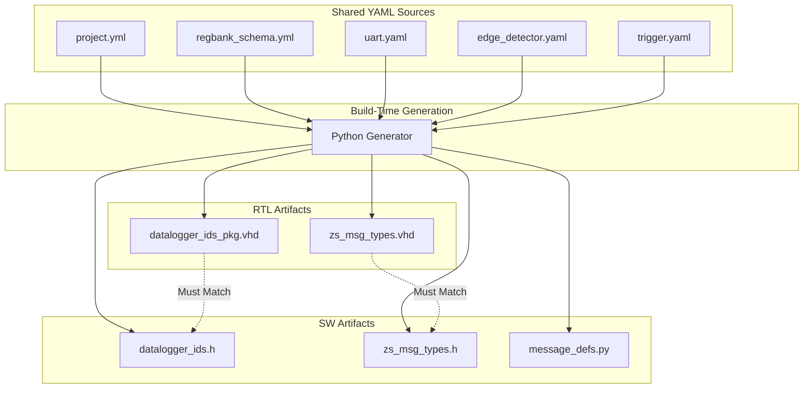

# Deepskopion System Requirements Roadmap

## Executive Summary

This document provides a comprehensive analysis of the Deepskopion system requirements based on the `docs/` folder. It identifies all shared RTL/SW interface definitions, message formats the software must process, and provides a verification checklist for each requirement.

---

## 1. Shared YAML Definitions (RTL ↔ SW Interface)

These YAML files define the **contract** between RTL and Software. They enable automated code generation for both C/Python headers and VHDL packages.

### 1.1 Payload Specifications

| File | Domain ID | Payload Size | Purpose |
|:-----|:---------:|:------------:|:--------|
| [uart.yaml](software/data_plane/message_formats/payloads/uart.yaml) | `0x01` | 8 bytes | Single decoded UART character with error flags |
| [edge_detector.yaml](software/data_plane/message_formats/payloads/edge_detector.yaml) | `0x02` | 4 bytes | Pin edge transitions (rising/falling) |
| [trigger.yaml](software/data_plane/message_formats/payloads/trigger.yaml) | `0x07` | Variable (6+ bytes) | Trigger match events with condition snapshot |

### 1.2 Register Bank Schema

| File | Registers | Purpose |
|:-----|:---------:|:--------|
| [regbank_schema.yml](https://github.com/djmazure/routertl/blob/main/tools/regbank-utils/regbank_schema.yml) | 48 | Memory-mapped control/status registers for PS↔PL communication |

**Key Register Categories:**
- **System Info (0-4)**: `GIT_HASH_VALUE`, `DSK_FW_VERSION`, `BUILD_DATE`, `REGISTER_BANK_VERSION`, `MANIFEST_NUM_WORDS`
- **Manifest Access (4-7)**: Sequential readout of self-describing schema
- **FIFO Status (9-26)**: Stream and Burst FIFO occupancy, overflow counters
- **Datalogger Control (29-31)**: `DSK_CONTROL`, `DSK_CONFIG`, `DSK_STATUS`
- **Timing (32-34)**: `TIMESTAMP`, `SYS_CLOCK_FREQ`, `EP_CLOCK_FREQ`
- **Pin Movement (45-47)**: Edge detection control and 48-pin status flags

### 1.3 Project Configuration

| File | Purpose |
|:-----|:--------|
| [project.yml](https://github.com/routertl/deepskopion/blob/main/project.yml) | Top-level project config (part, simulation, hooks) |
| [project_regbank.yml](https://github.com/routertl/deepskopion/blob/main/project_regbank.yml) | Project-specific register bank extensions (currently empty) |

---

## 2. Critical RTL/SW Shared Concepts

### 2.1 ID Generation Strategy

The system uses a **dual ID scheme** to decouple stable protocol semantics from dynamic build configurations:

| Concept | Type | Defined In | Generated By |
|:--------|:----:|:-----------|:-------------|
| **Domain/Event Code** | Static | Source code | Manual (versioned) |
| **Datalogger Instance ID** | Dynamic | `project.yml` | Build-time script |

**Flow:**
```
project.yml (dataloggers: [uart0, uart1])
    → Python Generator Script
    → datalogger_ids.h (C) + datalogger_ids_pkg.vhd (VHDL)
```

### 2.2 Event Code Bit Layout

| Bits | Width | Field | Description |
|:-----|:-----:|:------|:------------|
| [15:12] | 4 | **SEVERITY** | INFO(0), WARN(1), ERROR(2), DEBUG(3), CONTROL(4) |
| [11:8] | 4 | **DOMAIN** | SYS(0), UART(1), I2C(2), SPI(3), I2S(4), QSPI(5), EDGE(6), TRIG(7) |
| [7:0] | 8 | **EVENT_ID** | Protocol-specific event index |

---

## 3. Message Formats SW Must Process

### 3.1 Common Message Header (20 Bytes)

Every message from DDR follows this format (Little Endian):

| Offset | Size | Field | Description |
|:------:|:----:|:------|:------------|
| 0 | 2 | `magic` | Constant `'ZS'` (0x5A53) - sync marker |
| 2 | 1 | `version` | Protocol version (e.g., 0x01) |
| 3 | 1 | `header_len` | Header length in 32-bit words (5 = 20 bytes) |
| 4 | 1 | `datalogger_id` | **Dynamic** instance ID (build-generated) |
| 5 | 1 | `msg_class` | DATA(0), STATUS(1), TRIGGER(2), ERROR(3), CONTROL(4) |
| 6 | 2 | `msg_type` | Event code (Domain + Event ID) |
| 8 | 8 | `timestamp` | 64-bit global timestamp (lower 48 bits active) |
| 16 | 2 | `payload_len` | Bytes following header |
| 18 | 2 | `flags` | Dropped/truncated indicators |

### 3.2 Payload Structures

#### UART Payload (8 bytes)
| Offset | Size | Field | Type |
|:------:|:----:|:------|:-----|
| 0 | 1 | `uart_char` | uint8 |
| 1 | 1 | `parity_error` | bool |
| 2 | 1 | `frame_error` | bool |
| 3 | 1 | reserved | - |
| 4 | 2 | `oversample_period` | uint16 |
| 6 | 2 | reserved | - |

#### Edge Detector Payload (4 bytes)
| Offset | Size | Field | Type |
|:------:|:----:|:------|:-----|
| 0 | 1 | `pin` | uint8 |
| 1 | 1 | `edge` | 0=falling, 1=rising |
| 2 | 2 | reserved | - |

#### Trigger Payload (6+ bytes)
| Offset | Size | Field | Type |
|:------:|:----:|:------|:-----|
| 0 | 1 | `trigger_id` | uint8 |
| 1 | 1 | `flags` | bitfield |
| 2 | 2 | `condition_mask` | uint16 |
| 4 | 2 | `seq_number` | uint16 |
| 6 | dynamic | `snapshot_data` | uint8[] |

---

## 4. System Requirements Table

| ID | Category | Requirement | Verification Method |
|:--:|:---------|:------------|:--------------------|
| **R1** | Timing | 64-bit global timestamp at 1µs resolution | RTL sim: verify counter increments; SW: check timestamp monotonicity |
| **R2** | DMA | Ring buffer with N descriptors × B bytes each | SW: validate pointer wrapping; RTL: verify descriptor updates |
| **R3** | Framing | 20-byte `zs_msg_header_t` with `'ZS'` magic | SW parser: reject invalid magic; RTL: assert header format |
| **R4** | Discovery | BRAM manifest readable via `MANIFEST_DATA` register | SW: read and validate YAML schema from registers |
| **R5** | ID Sync | Datalogger IDs match between C header and VHDL package | Build: compare generated files; SW: validate against manifest |
| **R6** | Separation | Burst vs Stream FIFO isolation | Stress test: high burst traffic shouldn't starve stream |
| **R7** | Triggers | `TRIG_MATCH` message with exact-cycle timestamp | SW: verify trigger timestamp ordering vs data messages |
| **R8** | Registers | 48 registers accessible via UIO/mmap | SW: read all RO registers; write/read RW registers |
| **R9** | Errors | Overflow flags in message header | Inject FIFO full condition; verify flag in captured message |
| **R10** | Protocols | UART/Edge/Trigger payloads match YAML specs | Round-trip: RTL encode → SW decode → validate fields |

---

## 5. Roadmap Phases

Based on the [System Overview](SYSTEM_OVERVIEW.md):

### Phase 1: Foundation (The Data Pipe)
| Component | Deliverable | Verification |
|:----------|:------------|:-------------|
| FPGA | Zynq shell + AXI DMA + dummy generator | Vivado build passes; ILA shows DMA writes |
| Linux | UIO driver mapping DMA buffers | `/dev/uioX` accessible; `mmap()` succeeds |
| Server | Console dump of dummy traffic | Parsed messages match injected pattern |

### Phase 2: Protocol Integration
| Component | Deliverable | Verification |
|:----------|:------------|:-------------|
| RTL | UART/Edge datalogger blocks | Cocotb tests for each protocol FSM |
| Driver | Variable-rate buffering | Stress test with mixed burst/stream traffic |
| Decoding | C/Python message parsers | Unit tests with known byte sequences |

### Phase 3: GUI Orchestration
| Component | Deliverable | Verification |
|:----------|:------------|:-------------|
| Network | CP/DP socket protocol | Integration test: Zynq → PC loopback |
| GUI | Live stream visualization | Manual: verify waveform matches input signal |

---

## 6. Shared Pieces Dependency Graph



---

## 7. Verification Checklist

> [!IMPORTANT]
> Each requirement must have at least one automated test before Phase 2 completion.

| Requirement | Automated Test | Manual Test | Status |
|:------------|:--------------:|:-----------:|:------:|
| R1: Timestamp | `test_timestamp_resolution.py` | - | ☐ |
| R2: Ring Buffer | `test_dma_ring.py` | - | ☐ |
| R3: Header Framing | `test_header_parser.py` | - | ☐ |
| R4: Manifest | `test_manifest_read.py` | - | ☐ |
| R5: ID Sync | `check_id_sync.sh` (diff) | - | ☐ |
| R6: FIFO Isolation | Cocotb stress test | - | ☐ |
| R7: Trigger Ordering | `test_trigger_timestamp.py` | - | ☐ |
| R8: Register Access | `test_regbank.py` | - | ☐ |
| R9: Overflow Flags | `test_overflow_detection.py` | Visual FIFO_FULL counter | ☐ |
| R10: Payload Decode | `test_payloads.py` | - | ☐ |

---

## 8. Key Documentation References

| Topic | Location |
|:------|:---------|
| System Overview | [SYSTEM_OVERVIEW.md](SYSTEM_OVERVIEW.md) |
| FPGA Design | [fpga_design.md](hardware/fpga_design.md) |
| Software Architecture | [README.md](software/README.md) |
| Control Plane | [control_plane/](software/control_plane/) |
| Data Plane | [data_plane/](software/data_plane/) |
| Message Formats | [message_formats/](software/data_plane/message_formats/) |
| Trigger Architecture | [trigger_architecture.md](software/data_plane/trigger_architecture.md) |
