# Protocol Description Language (PDL) — Full-Stack Architecture

**Last Updated**: 2026-02-26

## Vision

A single YAML protocol definition that drives **both** the FPGA datalogger
hardware and the software protocol decoder. One source of truth, from
silicon to screen.

```mermaid
flowchart LR
    YAML["Protocol YAML\n(Customer-Defined)"]
    FPGA["FPGA Compiler\n(HDL Generation)"]
    SW["SW Decoder\n(PdlDecoder)"]
    REG["Register Bank\n(Self-Describing)"]
    UI["ProtocolAnalyzerWidget\n(Wireshark-Style)"]

    YAML -->|"Build Time"| FPGA
    YAML -->|"Runtime"| SW
    FPGA --> REG
    REG -->|"Auto-Discovery"| SW
    SW --> UI

    style YAML fill:#2d5016,stroke:#4a8c2a
    style FPGA fill:#803030,stroke:#bf5c5c
    style SW fill:#1e3a5f,stroke:#4a90d9
    style REG fill:#4a3080,stroke:#7c5cbf
    style UI fill:#1e3a5f,stroke:#4a90d9
```



---

## Layer Model

| Layer | Domain | Current Status | PDL Role |
|-------|--------|---------------|----------|
| **L0 — Physical** | PHY, GPIO, RGMII | ✅ Zybo PMOD Ethernet, GPIO | No change |
| **L1 — Transport** | UART, SPI, I2C, Ethernet | ✅ Datalogger IPs + SW translators | Bound via `transport:` field |
| **L2 — Framing** | Sync, length, CRC, escaping | ❌ Not yet | **YAML-defined** |
| **L3 — Application** | Message types, fields, enums | ❌ Not yet | **YAML-defined** |

---

## YAML Schema Overview

```yaml
protocol:
  name: "IndustrialBus"
  version: "1.0"
  transport: uart_8n1
  endianness: little               # default for all fields

  framing:
    sync: [0xAA, 0x55]
    length_field:
      offset: 2                    # byte offset after sync
      size: 1                      # 1 byte → max 255-byte payload
      includes_header: false
    crc:
      type: crc16_ccitt
      position: tail               # last 2 bytes of frame
      size: 2

  message_id_field:
    offset: 0                      # first byte of payload
    size: 1

  messages:
    - id: 0x01
      name: "HEARTBEAT"
      color: "#4a8c2a"             # green bubble
      fields:
        - name: seq_num
          offset: 1
          size: 2
          type: uint16
        - name: status
          offset: 3
          size: 1
          type: enum
          values:
            0: IDLE
            1: RUNNING
            2: ERROR
            3: FAULT

    - id: 0x02
      name: "SENSOR_DATA"
      color: "#4a90d9"             # blue bubble
      fields:
        - name: sensor_id
          offset: 1
          size: 1
          type: uint8
        - name: temperature
          offset: 2
          size: 2
          type: int16
          scale: 0.1
          unit: "°C"
        - name: pressure
          offset: 4
          size: 4
          type: float32
          unit: "bar"
        - name: flags
          offset: 8
          size: 1
          type: bitfield
          bits:
            0: alarm
            1: calibrated
            2-3: mode
```

---

## FPGA Side — Self-Describing Datalogger

### Compilation Flow

```mermaid
flowchart TD
    YAML["protocol.yaml"]
    COMP["PDL Compiler\n(Python Script)"]
    VHDL["Generated VHDL\n(Datalogger IP)"]
    ROM["Schema ROM\n(Register-Mapped)"]
    DMA["DMA Message Buffer"]

    YAML --> COMP
    COMP --> VHDL
    COMP --> ROM
    VHDL -->|"Parsed Messages"| DMA
    ROM -->|"AXI-Lite Reads"| SW["SW Auto-Discovery"]

    style YAML fill:#2d5016,stroke:#4a8c2a
    style COMP fill:#4a3080,stroke:#7c5cbf
    style VHDL fill:#803030,stroke:#bf5c5c
    style ROM fill:#803030,stroke:#bf5c5c
    style DMA fill:#803030,stroke:#bf5c5c
    style SW fill:#1e3a5f,stroke:#4a90d9
```



The **PDL Compiler** (a Python script in the RouteRTL toolchain) reads the
YAML and generates two outputs:

1. **Datalogger IP (VHDL)**: A state machine that implements the framing
   and message detection logic in hardware. Matched messages are written
   to a DMA ring buffer with timestamp + raw payload.

2. **Schema ROM**: A register-mapped read-only memory block that
   describes the protocol structure. The PS (software) reads this to
   auto-configure decoders without needing the original YAML file.

### Schema ROM Format

The schema is stored as a simple TLV (Type-Length-Value) table in
AXI-Lite addressable registers:

| Offset | Field | Size | Description |
|--------|-------|------|-------------|
| 0x00 | Magic | 4B | `0x50444C00` ("PDL\0") |
| 0x04 | Version | 2B | Schema version |
| 0x06 | Protocol name length | 2B | N |
| 0x08 | Protocol name | NB | UTF-8 string |
| ... | Message count | 2B | Number of message definitions |
| ... | Message entries | var | ID (1B) + name_len (1B) + name + field_count + fields |

Each field entry:

| Size | Content |
|------|---------|
| 1B | Field name length |
| NB | Field name (ASCII) |
| 1B | Type enum (uint8=0, uint16=1, int16=2, float32=3, enum=4, ...) |
| 1B | Offset within message payload |
| 1B | Size in bytes |
| 2B | Scale numerator (fixed-point, ×0.001 precision) |
| 2B | Scale denominator |
| var | Enum entries (if type=enum): count (1B) + {value (1B) + name_len (1B) + name}* |

### Reuse of Existing Datalogger Patterns

The generated VHDL follows the same architecture as the UART and Edge
Detector dataloggers:

- AXI-Stream output to DMA
- Standard message format: `[TIMESTAMP | MSG_ID | PAYLOAD | STATUS]`
- Control registers: enable, reset, status, error counters
- The "self-describing" part is the **addition of the Schema ROM**,
  which doesn't exist in the current hand-written dataloggers

---

## Software Side — PdlDecoder

### Architecture in logic-trace

```mermaid
flowchart LR
    YAML["protocol.yaml\n(File)"]
    ROM["Schema ROM\n(FPGA Registers)"]
    PDL["PdlDecoder\n(HighLevelTranslator)"]
    TR["Transport Translator\n(UART/SPI/I2C)"]
    DF["DecodedFrame[]"]
    PAW["ProtocolAnalyzerWidget"]

    YAML -->|"fromYaml()"| PDL
    ROM -->|"fromRegisters()"| PDL
    TR -->|"DecodedFrame[]\n(raw bytes)"| PDL
    PDL -->|"Decoded Messages"| DF
    DF --> PAW

    style YAML fill:#2d5016,stroke:#4a8c2a
    style ROM fill:#4a3080,stroke:#7c5cbf
    style PDL fill:#1e3a5f,stroke:#4a90d9
    style TR fill:#5c4033,stroke:#8b6914
    style DF fill:#1e3a5f,stroke:#4a90d9
    style PAW fill:#1e3a5f,stroke:#4a90d9
```



The `PdlDecoder` class can be instantiated from two sources:

1. **YAML file** — for offline analysis without hardware:
   ```cpp
   auto decoder = PdlDecoder::fromYaml("my_protocol.yaml");
   ```

2. **FPGA Schema ROM** — for live hardware capturing:
   ```cpp
   auto decoder = PdlDecoder::fromRegisters(datalogger_base_addr);
   ```

Both paths produce the same `PdlDecoder` instance — the decoder
doesn't care where its schema came from.

### Framing State Machine

```
                    ┌──────────┐
            ┌──────>│   IDLE   │<─────────┐
            │       └────┬─────┘          │
            │            │ sync match     │ CRC fail / timeout
            │       ┌────▼─────┐          │
            │       │   SYNC   │──────────┘
            │       └────┬─────┘
            │            │ length byte received
            │       ┌────▼─────┐
            │       │ PAYLOAD  │ ← collect N bytes
            │       └────┬─────┘
            │            │ N bytes collected
            │       ┌────▼─────┐
            │       │   CRC    │ ← validate
            │       └────┬─────┘
            │            │ CRC OK
            │       ┌────▼─────┐
            └───────│  EMIT    │ → DecodedFrame
                    └──────────┘
```

---

## Customer Workflow

```mermaid
flowchart TD
    C["Customer defines\nprotocol.yaml"]
    V["Our tooling validates\nYAML schema"]
    FPGA_BUILD["PDL Compiler generates\nDatalogger IP + Schema ROM"]
    SYNTH["Quartus/Vivado synthesis\n+ bitstream"]
    FLASH["Flash Zybo / ship device"]
    USE["Customer uses logic-trace\nto capture their protocol"]

    C --> V
    V --> FPGA_BUILD
    FPGA_BUILD --> SYNTH
    SYNTH --> FLASH
    FLASH --> USE

    style C fill:#2d5016,stroke:#4a8c2a
    style V fill:#4a3080,stroke:#7c5cbf
    style FPGA_BUILD fill:#803030,stroke:#bf5c5c
    style SYNTH fill:#803030,stroke:#bf5c5c
    style FLASH fill:#5c4033,stroke:#8b6914
    style USE fill:#1e3a5f,stroke:#4a90d9
```



### Delivery Models

| Model | What Ships | Customer Effort | Our Margin |
|-------|-----------|----------------|------------|
| **Self-Service** | YAML schema + open-source tooling | Customer generates bitstream | Low (SW support only) |
| **Pre-Built** | Zybo with their protocol pre-loaded | Plug and play | Medium (HW + integration) |
| **Engineering** | Custom board + multi-protocol datalogger | Zero — turnkey | High (NRE + device) |

---

## EtherCAT as First Commercial Target

EtherCAT is the ideal first customer-facing protocol because:

1. **High demand** — Industrial automation is the fastest-growing
   protocol analysis market segment
2. **Existing HW** — The Zybo PMOD Ethernet PHY is already tested
3. **Frame-based** — Exercises the full PDL stack (framing + datagrams)
4. **No good open-source alternatives** — Beckhoff ET2000 is expensive,
   Wireshark can only passively tap (no hardware correlation)

An EtherCAT PDL definition would include:
- Transport: `ethernet` (EtherType 0x88A4)
- Framing: Ethernet frame → EtherCAT header → datagrams
- Message types: LRD, LWR, LRW, BRD, BWR, APRD, APWR, etc.
- Sub-protocols: CoE (CANopen), FoE (File), SoE (Servo)
- Working counter tracking

The physical-layer and byte-level framing decisions are pinned in the
[EtherCAT link and framing research](ethercat/ETHERCAT_LINK_AND_FRAMING.md)
and its machine-readable `ethercat_wire_contract.yml`. That artifact is
research input only; it does not claim an Ethernet ingest path or EtherCAT RTL.

---

## Implementation Phases

| Phase | Scope | Where |
|-------|-------|-------|
| **1** | YAML schema spec + PdlDecoder in logic-trace | logic-trace Conv 27 |
| **2** | PDL Compiler → VHDL generation | Deepskopion |
| **3** | Schema ROM + SW auto-discovery | Deepskopion + logic-trace |
| **4** | EtherCAT PDL definition + dual-PHY tap | Deepskopion HW |
| **5** | Customer-facing tooling + packaging | Monetization |

---

*Cross-references*:
- See the logic-trace repository for the Translator pipeline
  and datalogger subsystem architecture.
- [Datalogger Documentation Guide](../standards/datalogger_documentation_guide.md)
  — Existing per-IP YAML definitions
