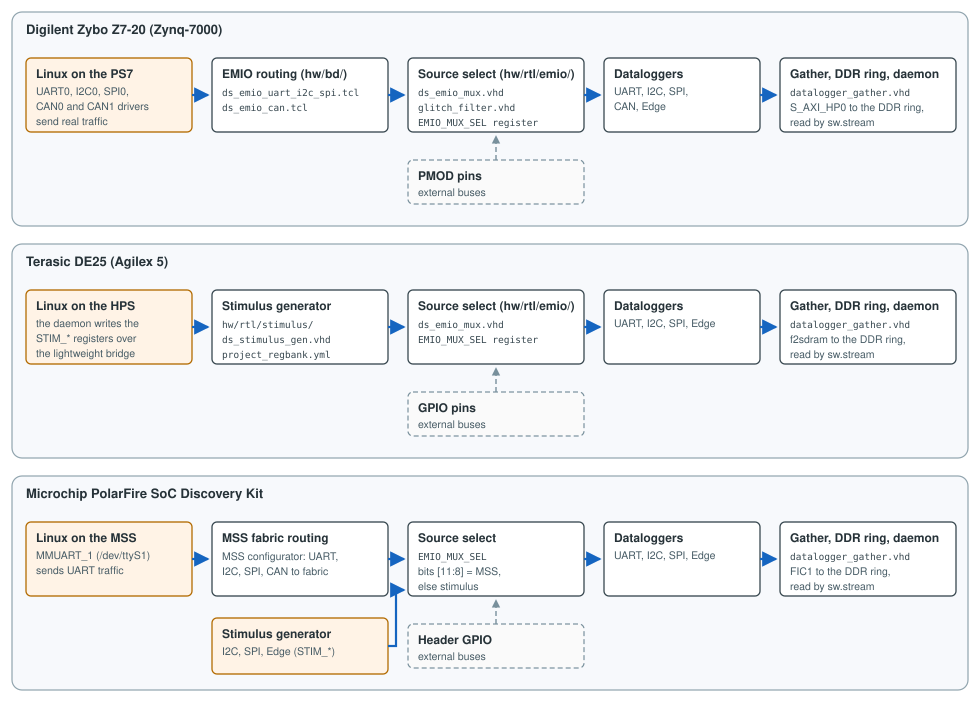

# In-system self-test

On the Zybo Z7-20, the DE25 and the PolarFire SoC Discovery Kit, the default targets generate bus traffic for six of the nine data loggers of the default mix, so those loggers capture with the board alone. The other three need external traffic on their header pins. The reach is the same on all three boards; it is measured in simulation by [`test_selftest_coverage.py`](https://github.com/routertl/deepskopion/blob/main/hw/sim/cocotb/tests/datalogger/infra/default_mix/test_selftest_coverage.py). On the PolarFire SoC Discovery Kit the six data loggers also decode their self-test traffic on the board.

| Data logger | Board-alone source |
|---|---|
| Edge 1 | The edge stimulus, or the I2C or SPI edge route; on the Zybo Z7-20 also the CAN edge route, and on the PolarFire SoC Discovery Kit also the UART edge route |
| Edge 2 | The I2C or SPI edge route |
| Edge 3 | The SPI edge route: the on-chip SPI responder (spi_injector) answers each byte of the SPI stimulus on MISO |
| I2C 4 | The I2C stimulus |
| I2C 5 | None: external traffic only |
| SPI 8 | The SPI stimulus |
| UART 12 | The UART stimulus (on the PolarFire SoC Discovery Kit, MMUART_1) |
| UART 13 | None: external traffic only |
| CAN 20 | None: external traffic only. The SPI edge route also drives this input with the SPI chip-select, which is not CAN traffic. |

The SPI edge route reaches Edge 1, Edge 2 and Edge 3 when it is requested together with the SPI stimulus, which writes the route before the first byte:

```bash
BOARD_IP=board-ip   # the board's address
python3 -m sw.stream.testbench.live_capture_client --host "$BOARD_IP" --stim spi --edge-route spi
```


| Board | Traffic source | Sources |
|---|---|---|
| Zybo Z7-20 | The stimulus block in the fabric drives the EMIO input lines while a protocol's `STIM_*_CONTROL` enable bit is set; otherwise the Linux drivers on the PS peripherals drive them over EMIO. The `EMIO_MUX_SEL` register selects the input. | [`hw/bd/ds_emio_uart_i2c_spi.tcl`](https://github.com/routertl/deepskopion/blob/main/hw/bd/ds_emio_uart_i2c_spi.tcl), [`hw/bd/ds_emio_can.tcl`](https://github.com/routertl/deepskopion/blob/main/hw/bd/ds_emio_can.tcl), [`hw/rtl/emio/ds_emio_mux.vhd`](https://github.com/routertl/deepskopion/blob/main/hw/rtl/emio/ds_emio_mux.vhd), [`hw/rtl/emio/glitch_filter.vhd`](https://github.com/routertl/deepskopion/blob/main/hw/rtl/emio/glitch_filter.vhd), [`hw/rtl/stimulus/ds_stimulus_gen.vhd`](https://github.com/routertl/deepskopion/blob/main/hw/rtl/stimulus/ds_stimulus_gen.vhd) |
| DE25 | A stimulus block in the fabric, controlled from Linux through the `STIM_*` registers. | [`hw/rtl/stimulus/ds_stimulus_gen.vhd`](https://github.com/routertl/deepskopion/blob/main/hw/rtl/stimulus/ds_stimulus_gen.vhd), [`project_regbank.yml`](https://github.com/routertl/deepskopion/blob/main/project_regbank.yml) |
| PolarFire SoC Discovery Kit | Linux writes UART traffic on MMUART_1 (`/dev/ttyS1`), which the MSS routes to the fabric. `EMIO_MUX_SEL` bits [11:8] select the MSS I2C, UART, SPI and CAN; this image arms the UART bit only. I2C, SPI and edge traffic come from the fabric stimulus block through the `STIM_*` registers. | [`hw/rtl/pfsoc/deepskopion_pfsoc_top.vhd`](https://github.com/routertl/deepskopion/blob/main/hw/rtl/pfsoc/deepskopion_pfsoc_top.vhd), [`hw/libero/pfsoc/pfsoc_mss_subsys.tcl`](https://github.com/routertl/deepskopion/blob/main/hw/libero/pfsoc/pfsoc_mss_subsys.tcl), [`hw/rtl/stimulus/ds_stimulus_gen.vhd`](https://github.com/routertl/deepskopion/blob/main/hw/rtl/stimulus/ds_stimulus_gen.vhd) |


