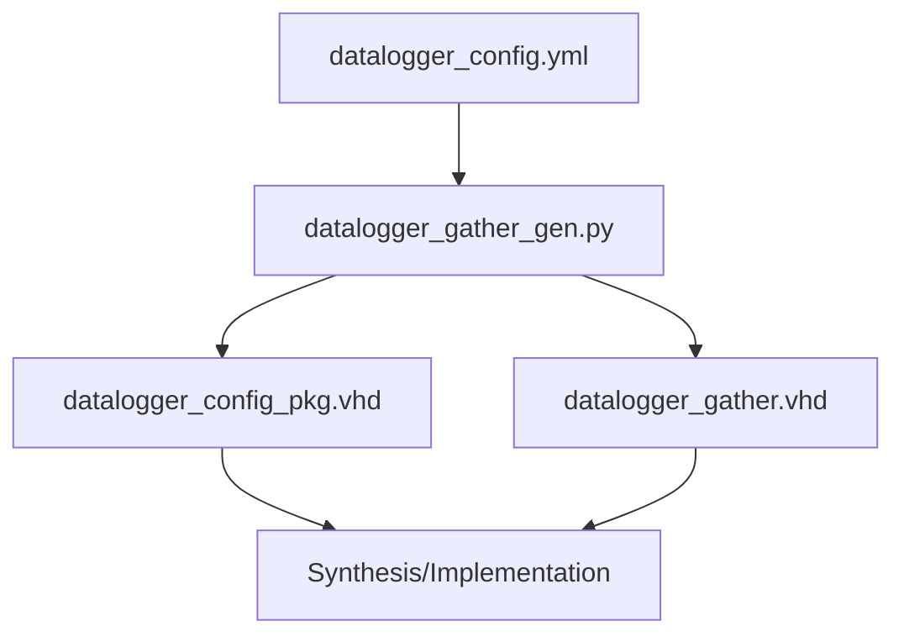

# Datalogger Builder Flow

The datalogger builder enables dynamic hardware configuration by transforming a high-level YAML definition into RTL structures for the Deepskopion protocol analysis system.

## Overview

The process generates VHDL configuration packages and gather modules from a single YAML source.



## Tool: `datalogger_gather_gen.py`

Located in `tools/datalogger-builder/`, this script parses the YAML configuration and generates:

| Output | Description |
| ------ | ----------- |
| `datalogger_config_pkg.vhd` | Constants, types, pin mappings, and ID arrays |
| `datalogger_gather.vhd` | Protocol instantiation and arbiter connections |

### Usage

```bash
python3 datalogger_gather_gen.py config/datalogger_config.yml \
    --pkg-dir hw/rtl/pkg \
    --rtl-dir hw/rtl/datalogger/infra
```

### Integration via Pre-Build Hook

The datalogger builder is invoked automatically during `make project` via a pre-build hook defined in `project.yml`:

```yaml
hooks:
  pre_build:
    - name: datalogger-builder
      script: tools/datalogger-builder/datalogger_gather_gen.py
      args:
        - tools/datalogger-builder/config/datalogger_config.yml
        - --pkg-dir
        - hw/rtl/pkg
        - --rtl-dir
        - hw/rtl/datalogger/infra
      expected_outputs:
        - hw/rtl/pkg/datalogger_config_pkg.vhd
        - hw/rtl/datalogger/infra/datalogger_gather.vhd
```

## Configuration Format

The YAML configuration defines datalogger instances, pin mappings, and protocol types:

```yaml
Design: deepskopion

Constraints:
  NumDataloggerPins: 64
  MaxDataloggerID: 31

Timesync: 0  # Datalogger ID for timestamp sync

Dataloggers:
  Stream:
    I2C:
      1: { scl: 10, sda: 11 }
      2: { scl: 12, sda: 13 }
    UART:
      3: { rx: 20 }
  Burst:
    QSPI:
      4: { clk: 30, cs: 31, d0: 32, d1: 33, d2: 34, d3: 35 }
```

## Benefits

1. **Single Source of Truth**: Hardware configuration derives from one YAML file
2. **Consistent Mapping**: Datalogger IDs, pin assignments, and arbiter indexes are auto-generated
3. **Type Safety**: Generated VHDL packages ensure compile-time validation
