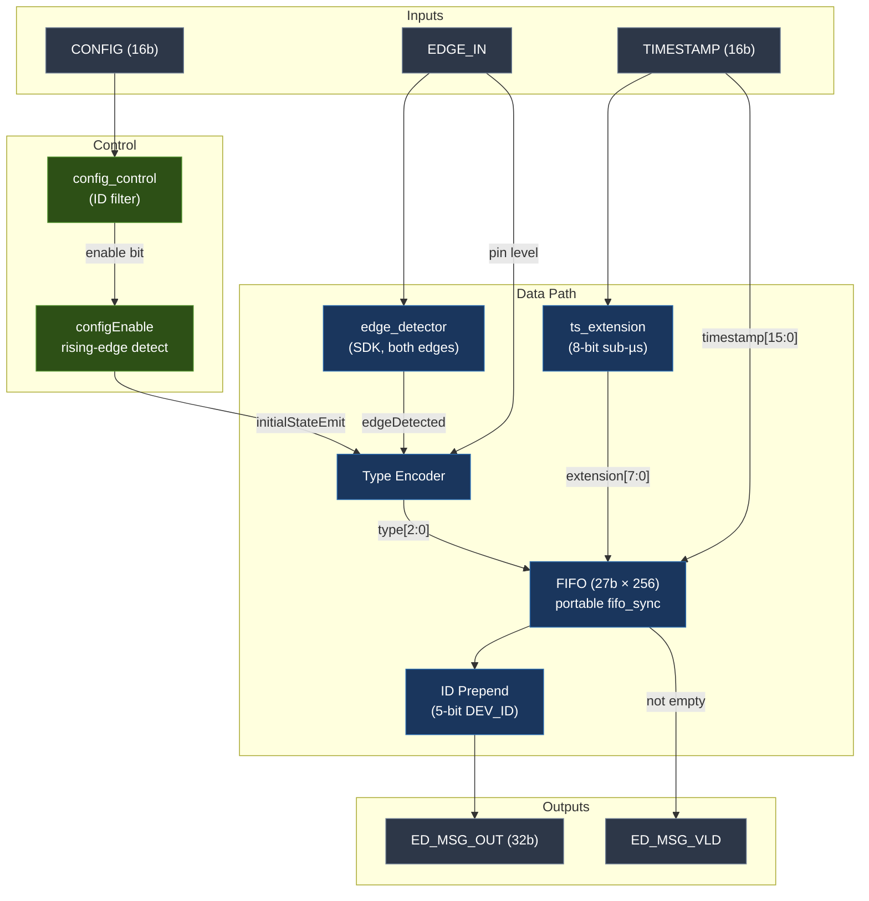

# Edge Detector Datalogger v2 — Firmware Design Document

**Module**: `edge_datalogger.vhd`
**Location**: `hw/rtl/datalogger/nonstd/edge_datalogger.vhd`
**Version**: 2.0 (pending implementation)
**Author**: RTL Architect review, Feb 27 2026

---

## 1. Purpose

The Edge Detector is a **protocol-agnostic toggle capture engine**.
It records every level transition on a single input pin with **10 ns
precision** at 100 MHz, completely indifferent to what generates them
— whether it's an SPI clock, a UART line, a GPIO flag, or an
interrupt. Its sole job is to faithfully timestamp every toggle and
serve that waveform to logic-trace.

It is the simplest datalogger in the Deepskopion platform. v2 brings it
into compliance with the standard datalogger message contract.

### What the Edge Detector Really Is

The edge detector is a **high-resolution event timestamper**, not a
"1-bit data transporter." Its payload is the *moment* a signal
transitions — a 24-bit timestamp (16 µs + 8 sub-µs) plus 1 bit of
polarity.

| Cost Model | Payload | Overhead | Efficiency |
|:-----------|:--------|:---------|:-----------|
| ❌ Old ("1-bit data") | 1 bit | 31 bits | 3.1% |
| ✅ v2 ("timestamp + polarity") | 27 bits | 5 bits | **84.4%** |

The 3.1% metric was a flawed framing. **Do not cite it.**

---

## 2. Message Format

All messages are 32 bits, following the standard datalogger word layout:

```text
┌───────────┬──────────┬──────────────┬───────────┐
│ device_id │   type   │  timestamp   │   data    │
│  [31:27]  │ [26:24]  │   [23:8]     │  [7:0]    │
│   5 bits  │  3 bits  │   16 bits    │  8 bits   │
└───────────┴──────────┴──────────────┴───────────┘
```

### 2.1 Type Codes

| Code | Name | Description |
|:-----|:-----|:-----------|
| `0b010` | `RISING` | Rising edge detected (low → high) |
| `0b011` | `FALLING` | Falling edge detected (high → low) |
| `0b100` | `STATUS` | Status event (initial state report) |

These align with UART's type field encoding:

| Code | UART | Edge |
|:-----|:-----|:-----|
| `0b001` | CONFIG | — (no auto-calibration) |
| `0b010` | PAYLOAD | RISING edge |
| `0b011` | PAYLOAD_B9 | FALLING edge |
| `0b100` | STATUS | STATUS (initial state) |

### 2.2 Edge Event Messages (`type = 0b010 / 0b011`)

Emitted on each detected signal transition.

| Field | Bits | Description |
|:------|:-----|:-----------|
| `device_id` | [31:27] | Datalogger instance ID |
| `type` | [26:24] | `0b010` = rising, `0b011` = falling |
| `timestamp` | [23:8] | Lower 16 bits of global 1 µs counter |
| `extension` | [7:0] | Sub-µs counter (0–99 at 100 MHz, 10 ns resolution) |

**Full timestamp reconstruction:**

```python
timestamp_ns = timestamp_us * 1000 + extension * (1000 // clk_mhz)
# At 100 MHz: timestamp_ns = timestamp * 1000 + extension * 10
```

**Edge polarity logic**: The SDK `edge_detector` with `G_EDGE_TYPE =
C_EDGE_TYPE_BOTH` fires a single-cycle pulse on either transition.
At the moment Q=1, the current value of `EDGE_IN` tells us the
edge direction:

- `EDGE_IN = '1'` → just went high → **RISING** (`0b010`)
- `EDGE_IN = '0'` → just went low → **FALLING** (`0b011`)

### 2.3 Status Message (`type = 0b100`)

Emitted **once** on the rising edge of `configEnable`.

| Field | Bits | Description |
|:------|:-----|:-----------|
| `device_id` | [31:27] | Datalogger instance ID |
| `type` | [26:24] | `0b100` (STATUS) |
| `timestamp` | [23:8] | Timestamp at enable moment |
| `status_code` | [7:0] | Initial state code |

**Status codes:**

| Code | Name | Meaning |
|:-----|:-----|:--------|
| `0x00` | `INITIAL_STATE_LOW` | Pin was low when datalogger was enabled |
| `0x01` | `INITIAL_STATE_HIGH` | Pin was high when datalogger was enabled |

This solves the "first edge ambiguity" — software no longer needs
to infer the initial level from the first edge polarity.

---

## 3. Configuration

The CONFIG bus is 16 bits wide. The `config_control` entity filters
by `device_id` in bits [15:11].

| CONFIG[0] | Mode | Behavior |
|:----------|:-----|:---------|
| `0` | Disabled | No capture (reset state) |
| `1` | Enabled | Emit initial state, then capture all edges |

v1 had four modes (`00/01/10/11`); v2 simplifies to a single enable
bit. The SW-triggered readback (ReadEvent) is **permanently removed** —
the auto initial-state STATUS message provides superior functionality.

---

## 4. Error Reporting Architecture

> [!IMPORTANT]
> **Error reporting is arbiter-owned.** The edge datalogger does NOT emit
> error messages itself.

The arbiter has **full visibility** of all datalogger output FIFOs and is
the entity responsible for accepting new messages. When a datalogger's
FIFO is full and the arbiter cannot service it in time, the arbiter
— not the datalogger — reports the overflow.

This design follows the principle: *the entity that controls the
resource reports its exhaustion.*

**Per-datalogger implications:**

- The `ED_ERRORS` port remains available but is **not driven** by
  the edge datalogger RTL
- The `F` bit (FIFO pressure) is removed from the data stream
- FIFO overflow results in silent event dropping at the datalogger level;
  the arbiter detects and reports the gap

**Future (Phase 2):** A centralized `error_reporter.vhd` entity
will monitor all arbiter-input FIFOs and emit STATUS messages with
overflow timestamps and source datalogger IDs.

---

## 5. Internal Architecture

### 5.1 Block Diagram



### 5.2 Resource Estimate (per instance)

| Component | Flops | LUTs | Notes |
|:----------|:------|:-----|:------|
| config_control | ~16 | ~12 | Shared infra |
| Timestamp extension | ~24 | ~8 | 16b register + 8b counter |
| edge_detector (SDK) | ~3 | ~4 | D-ff + XOR |
| Enable rising-edge detect | ~1 | ~2 | configEnable_prev + AND |
| Type encoder | ~0 | ~6 | Combinational mux |
| FIFO write mux | ~0 | ~6 | 3-condition priority |
| `fifo_sync` (256×27b) | measured with full target | measured with full target | open-logic FIFO; see `docs/GOLDEN_PATH.md` DS-R0 evidence |
| Output mux | ~0 | ~8 | ID prepend + valid |
| **Total** | **~100** | **~94** | |

System-wide (5 instances): **~500 flops, ~470 LUTs.**

Compared to v1 (~103 flops, ~100 LUTs): **-3 flops, -6 LUTs per
instance** from removing ReadEvent logic, partially offset by the
enable-edge detection flop.

### 5.3 FIFO Write Conditions

Simplified from v1's 6-level mux to 3 conditions:

```vhdl
fifoEdWrEn <= '0' when fifoEdRstBusy  = '1' else
              '1' when initialStateEmit = '1' else
              '1' when edgeDetected = '1'
                   and configEnable = '1'
                   and fifoEdFull = '0'   else
              '0';
```

---

## 6. Bandwidth Analysis

### 6.1 Competitive Reference: Saleae Logic Pro 16

| Config | Saleae Digital Sampling | Bandwidth to Host |
|:-------|:------------------------|:-------------------|
| 4 channels | **500 MSPS** | USB 3.0, ~5 Gbps |
| 8 channels | 250 MSPS | USB 3.0 |
| 16 channels | **100 MSPS** | USB 3.0 |

Saleae streams **raw samples** (1 bit per channel per sample) over
USB. At 100 MSPS × 16 channels = 1.6 Gbps of raw data, compressed
on-device before USB transfer.

Deepskopion's edge datalogger takes a fundamentally different approach:
**event-driven** rather than continuous sampling. It only emits a
32-bit word when something *changes*. This is dramatically more
efficient for sparse signals, but saturates earlier on fast signals.

### Saleae's Maximum Input Signal Frequency

Saleae's 500 MSPS sampling rate does **not** mean it captures
500 MHz signals. The relationship:

| Concept | Saleae Value | Deepskopion Equivalent |
|:--------|:-------------|:-----------------------|
| **Sampling rate** | 500 MSPS (4ch) | 100 MHz PL clock |
| **Max digital input BW** | **100 MHz** | **50 MHz** (Nyquist) |
| **Recommended oversampling** | 4× (500/100 = 5×) | 2× (Nyquist minimum) |
| **Reliable input freq** | ~25 MHz at 4× oversample | ~10 MHz at 10× oversample |

Saleae recommends **4× oversampling** for reliable digital capture.
At 500 MSPS, that means signals up to **~125 MHz** can be captured
with 4 channels — but their *specified* digital bandwidth is
**100 MHz**.

For Deepskopion at 100 MHz PL clock, the **hard Nyquist limit** is
50 MHz (one edge per clock cycle). With practical 4× oversampling
for quality, reliable capture is **~25 MHz**. However, this is the
*detection* limit — the *transport* bandwidth to host is the real
constraint (see §6.2).

### How Saleae Achieves 500 MSPS (Probable Technique)

Saleae's internal architecture is proprietary, but the technique
is standard FPGA practice — **ISERDES with DDR I/O**:

```text
Input Pin ──► ISERDES (1:5 or 1:8 deserializer)
                  ├── Phase 0 (0°)    ──► sample[0]
                  ├── Phase 1 (72°)   ──► sample[1]
                  ├── Phase 2 (144°)  ──► sample[2]
                  ├── Phase 3 (216°)  ──► sample[3]
                  └── Phase 4 (288°)  ──► sample[4]
              Internal FPGA runs at 100 MHz
              But captures 5 samples per clock = 500 MSPS
```

| Technique | Mechanism | Effective Rate |
|:----------|:----------|:---------------|
| **DDR sampling** | Sample on both clock edges | 2× clock |
| **ISERDES 1:4** | 4-phase deserialization | 4× clock |
| **ISERDES 1:5** | 5-phase deserialization | **5× clock** |
| **ISERDES 1:8** | 8-phase deserialization | 8× clock |

With a 100 MHz internal clock and 1:5 ISERDES, you get **500 MSPS**
without the FPGA fabric running anywhere near 500 MHz. The I/O
serializer hardware does the heavy lifting at the pin level.

**Could Deepskopion do this?** Yes — the Zynq 7020 has ISERDES2
primitives that support up to 1:8 deserialization. At 100 MHz base
clock, that would give **800 MSPS per pin**. However:

- The current edge datalogger architecture uses fabric-level
  `edge_detector` (D-ff + XOR), not ISERDES
- ISERDES is a raw sampling technique — it would require a
  completely different data path (continuous sample stream, not
  event-driven)
- It would turn Deepskopion into a Saleae clone rather than playing
  to its strengths (protocol-aware, multi-channel, event-driven)

> [!TIP]
> **Architect's position:** ISERDES oversampling is the *wrong*
> investment for Deepskopion. Our advantage is **protocol-aware
> event capture across 23+ simultaneous channels**, not raw sample
> rate on 4 channels. A future "high-speed edge" mode using ISERDES
> could be a Phase 5+ feature for specific use cases (e.g., clock
> jitter measurement), but it's not the core product.

### 6.2 Zynq 7020 System Bandwidth Bottleneck

The data path from PL to host passes through the Zynq PS:

```text
Datalogger → Arbiter → AXI DMA → HP AXI Port → DDR → PS CPU → USB/Ethernet → Host
```

| Bottleneck | Theoretical Max | Practical Max | Notes |
|:-----------|:----------------|:--------------|:------|
| HP AXI Port (64-bit @100 MHz) | 800 MB/s | **~284 MB/s** | Single port, measured |
| HP AXI Port (64-bit @250 MHz) | 2 GB/s | ~700 MB/s | Max freq, competitive |
| DDR controller (total) | 4,264 MB/s | ~1,510 MB/s | All 4 HP ports saturated |
| Gigabit Ethernet | 125 MB/s | **~100 MB/s** | **Planned transport** |
| USB 2.0 (Zybo) | 60 MB/s | ~35 MB/s | Current, to be replaced |

> [!IMPORTANT]
> **With Gigabit Ethernet, the sustained throughput rises to ~100 MB/s**
> (800 Mbps) = **~25 million 32-bit messages/sec**. This is a 3×
> improvement over USB 2.0 and shifts the bottleneck back to the HP
> AXI port (~284 MB/s practical). At this rate, the edge datalogger in
> event mode comfortably handles I2C Fast (400 kHz) and approaches
> SPI 1 MHz territory without compression.
>
> With Ethernet, the system bandwidth hierarchy becomes:
>
> ```text
> HP AXI (~284 MB/s) > GbE (~100 MB/s) > Datalogger demand
> ```

### 6.3 Edge Datalogger Operating Envelope

The edge datalogger is **protocol-agnostic**: it captures every toggle
on the input pin, regardless of what generates it. It emits **one
32-bit message per toggle** — no protocol decoding, no compression,
just raw event timestamping.

**How the edge detector bandwidth is calculated:**

The edge detector emits exactly **one 32-bit message** for every
level transition it detects. It doesn't care what the signal is — it
just sees toggles. So the bandwidth consumed on the internal bus is:

```text
BW = toggles_per_second × 32 bits_per_message
```

**Worked example — UART at 9600 baud:**

A UART line at 9600 baud toggles approximately 9,600 times per
second (worst case: alternating 0-1 data creates one toggle per bit
period). The edge detector sees each toggle and emits a 32-bit
message for it:

```text
9,600 toggles/sec × 32 bits/msg = 307,200 bits/sec = 0.3 Mbps
```

Note: we multiply by 32 (not by 1 or by 8) because each toggle
costs a **full 32-bit message** on the bus: 5-bit device_id + 3-bit
type + 16-bit timestamp + 8-bit extension. The actual "new
information" per toggle is just the edge polarity (1 bit), but the
message overhead is the price of protocol compliance and timestamp
precision.

**Worked example — SPI clock at 20 MHz:**

A 20 MHz SPI clock toggles 40 million times per second (rising +
falling edge):

```text
40,000,000 toggles/sec × 32 bits/msg = 1,280,000,000 bits/sec = 1,280 Mbps
```

That exceeds GbE capacity (800 Mbps) by 160%. This is the hard
limit of event mode at high toggle rates.

| Input Signal | Toggle Rate | Toggles/s × 32 bits/msg | = Bus BW | vs GbE (800 Mbps / 100 MB/s) |
|:-------------|:------------|:------------------------|:---------|:------------------------------|
| GPIO / IRQ | <1 kHz | <1,000 × 32 = 32,000 bps | 0.03 Mbps (0.004 MB/s) | <0.01% ✅ |
| UART RX 9600 | 9.6 kHz | 9,600 × 32 = 307,200 bps | 0.3 Mbps (0.04 MB/s) | <0.04% ✅ |
| PWM 50 kHz | 100 kHz | 100,000 × 32 = 3,200,000 bps | 3.2 Mbps (0.4 MB/s) | 0.4% ✅ |
| I2C SCL 100 kHz | 200 kHz | 200,000 × 32 = 6,400,000 bps | 6.4 Mbps (0.8 MB/s) | 0.8% ✅ |
| I2C SCL 400 kHz | 800 kHz | 800,000 × 32 = 25,600,000 bps | 25.6 Mbps (3.2 MB/s) | 3.2% ✅ |
| SPI CLK 1 MHz | 2 MHz | 2,000,000 × 32 = 64,000,000 bps | 64 Mbps (8 MB/s) | 8% ✅ |
| UART RX 3 Mbaud | ~6 MHz | 6,000,000 × 32 = 192,000,000 bps | 192 Mbps (24 MB/s) | 24% ✅ |
| SPI CLK 10 MHz | 20 MHz | 20,000,000 × 32 = 640,000,000 bps | 640 Mbps (80 MB/s) | **80%** ⚠️ |
| SPI CLK 20 MHz | 40 MHz | 40,000,000 × 32 = 1,280,000,000 bps | 1,280 Mbps (160 MB/s) | **160%** ❌ |
| QSPI CLK 50 MHz | 50 MHz | 50,000,000 × 32 = 1,600,000,000 bps | 1,600 Mbps (200 MB/s) | **200%** ❌ |

> [!IMPORTANT]
> The edge datalogger has **no protocol opinion**. It can capture any of
> these signals. Its only limitation is **bandwidth**: at high toggle
> rates (>10 MHz), the raw 1-msg-per-toggle model exceeds GbE
> capacity. This is where compression (§7 Stream-RLE) and the DDR
> burst buffer (§6.5) extend the operating range.

**Limitations and alternatives at high toggle rates (>10 MHz):**

| Approach | Effect | Trade-off |
|:---------|:-------|:----------|
| **Event mode** (current v2) | 1 msg/toggle, no compression | Exceeds GbE at >10 MHz |
| **Stream-RLE** (Phase 4) | 3:1 compression → 3× capacity | Loses per-edge timestamps |
| **DDR burst buffer** | Absorbs bursts above GbE rate | Time-limited (5.1s at 2× GbE) |
| **ISERDES oversampling** (future) | 800 MSPS per pin | Requires new data path |

### 6.4 Bandwidth Summary

```text
                     Event Mode                     Stream-RLE
                     ──────────                     ──────────
GPIO/IRQ ────────┐
PWM 50 kHz ──────┤   ✅ Comfortable
I2C 100k ────────┤   (< 13 Mbps, <2% GbE)
UART 115200 ─────┘
                       ──────── Higher toggle rates ────────
I2C 400k ────────┐                      ┌──────────────────────
SPI 1 MHz ───────┤   ✅ Fine             │  ✅ 3× compression
UART 3 Mbaud ────┤   (25–192 Mbps)      │     extends range to
SPI 5 MHz ───────┘                      │     ~30 MHz effective
                                        └──────────────────────
SPI 10 MHz ──────┐
SPI 20 MHz ──────┤   ⚠️ Exceeds GbE sustained
QSPI 50 MHz ─────┘   → needs RLE + DDR burst absorption
```

**Architect's verdict:** The edge detector faithfully captures
any signal it's routed. Below ~10 MHz toggle rate, event mode
works without concern. Between 10–30 MHz, Stream-RLE (Phase 4)
keeps the data within GbE limits. Above 30 MHz, DDR burst
absorption provides seconds of capture headroom. The user chooses
whether to route a signal to the edge datalogger or to a protocol-
specific datalogger based on whether they want raw waveform capture
or decoded data — that's a **routing decision, not a limitation
of the edge detector**.

### 6.5 UART Datalogger: Protocol-Level Packing in Practice

The UART datalogger demonstrates the packing advantage. Looking at
[uart_datalogger.vhd](../../uart/uart_datalogger.vhd):

```text
UART Pin → Edge Detector → FIFO (edge + relative distance)
                                     ↓
                              uart_playback (waveform reconstruction)
                                     ↓
                              uart_frame_gen (byte extraction)
                                     ↓
                           1 message per decoded byte
```

**Compression chain:**

| Stage | Data Volume | Compression |
|:------|:------------|:------------|
| Raw edges (UART 115200, 8N1) | ~18 edges per byte | 1:1 |
| After uart_playback + frame_gen | 1 msg per byte (32 bits) | **~18:1** |
| On the bus | 11,520 msg/sec × 32 bits | 0.37 Mbps |

The `uart_playback` entity reconstructs the waveform from stored
edge distances, and `uart_frame_gen` extracts complete bytes with
timestamps. This is the **exact pattern** the Stream-RLE compressor
would follow for the edge datalogger — accumulate events locally, then
emit a compressed word.

### 6.6 Deepskopion Real Capacity: The Multi-Channel Advantage

Saleae wins on single-channel raw speed. Deepskopion wins on
**simultaneous protocol-aware channels**. Let's quantify.

#### Current Datalogger Fleet (from `datalogger_config_pkg`)

Unlike the edge detector (which emits 1 message per toggle),
**protocol dataloggers decode complete frames/bytes in hardware** and
emit only 1 message per decoded unit. This dramatically reduces bus
traffic. The calculation is different from the edge detector:

```text
Step 1: bytes_per_second = protocol_clock ÷ bits_per_frame
Step 2: messages_per_second = bytes_per_second  (1 msg per byte)
Step 3: bus_bw = messages_per_second × 32 bits_per_message
```

**Worked example — SPI at 20 MHz:**

```text
Step 1: 20,000,000 CLK ÷ 8 clk/byte = 2,500,000 bytes/sec
Step 2: 2,500,000 msg/sec  (1 message per decoded byte)
Step 3: 2,500,000 × 32 = 80,000,000 bps = 80 Mbps
```

Compare this to the edge detector capturing the same SPI clock:
40,000,000 toggles × 32 = 1,280 Mbps. The protocol datalogger is
**16× more efficient** because it decodes 8 toggles into 1 byte
before emitting.

**Worked example — QSPI at 50 MHz:**

QSPI uses 4 parallel data lines, so each clock cycle transfers
4 bits simultaneously:

```text
Step 1: 50,000,000 CLK × 4 lines = 200,000,000 bits/sec
        200,000,000 ÷ 8 bits/byte = 25,000,000 bytes/sec
Step 2: 25,000,000 msg/sec
Step 3: 25,000,000 × 32 = 800,000,000 bps = 800 Mbps
```

| Type | N | Pins | Protocol Math | Msg/sec/ch | × 32 bits | BW/ch |
|:-----|:-:|:----:|:--------------|:-----------|:----------|:------|
| UART | 6 | 1 | 115,200 baud ÷ 10 bits/frame | 11,520 | 368,640 bps | 0.37 Mbps |
| UART (max) | 6 | 1 | 3,000,000 baud ÷ 10 bits/frame | 300,000 | 9,600,000 bps | 9.6 Mbps |
| I2C | 4 | 2 | 400,000 SCL ÷ 9 clk/byte | 44,444 | 1,422,208 bps | 1.4 Mbps |
| SPI | 4 | 4 | 20,000,000 CLK ÷ 8 clk/byte | 2,500,000 | 80,000,000 bps | **80 Mbps** |
| QSPI | 1 | 6 | 50,000,000 CLK × 4 lines ÷ 8 bits | 25,000,000 | 800,000,000 bps | **800 Mbps** |
| Edge | 5 | 1 | 1 msg per toggle (varies) | varies | varies | varies |
| I2S | 2 | 3 | continuous stream | ~1,000,000 | 32,000,000 bps | 32 Mbps |
| Timestamp | 1 | — | 1 msg per 16.384 ms wrap | 61 | 1,952 bps | ≈0 |
| **Total** | **23** | **34** | | | | |

> [!TIP]
> **SPI at 20 MHz = 80 Mbps per channel.** That's a single HP AXI
> port handling 28 SPI channels simultaneously. There is no bandwidth
> concern for any protocol we currently capture.

#### Worst-Case Scenario: Everything Active

Protocol dataloggers emit **1 message per decoded frame/byte**, not per
toggle. Only edge dataloggers emit per-toggle.

```text
6× UART 115200:    6 × 11.5K   =      69,000 msg/s   =    2.2 Mbps
4× I2C 400kHz:     4 × 50K     =     200,000 msg/s   =    6.4 Mbps
4× SPI 20MHz:      4 × 2.5M    =  10,000,000 msg/s   =  320   Mbps
5× Edge 10kHz:     5 × 20K     =     100,000 msg/s   =    3.2 Mbps
1× QSPI 50MHz:    1 × 12.5M    =  12,500,000 msg/s   =  400   Mbps
2× I2S (stream):               ≈   2,000,000 msg/s   =   64   Mbps
1× Timestamp:                  ≈          61 msg/s   =    0   Mbps
──────────────────────────────────────────────────────────────────────
TOTAL:                         ≈  24,869,061 msg/s   ≈  795.8 Mbps
```

**Still fits within GbE (~800 Mbps)** — and this is the absolute
worst case with **4× SPI at 20 MHz** and a **QSPI at 50 MHz**, all
running simultaneously. In practice this scenario is extreme.

Note: the HP AXI can burst at ~284 MB/s = 2,272 Mbps per port.
With 4 HP ports available, PL→DDR burst capacity is **~1.5 GB/s**.
The sustained GbE drain (~100 MB/s) is the only real limit, and DDR
absorbs any instantaneous excess.

#### Realistic Scenario: Typical Debug Session

```text
2× UART 3Mbaud:    2 × 300K   =     600,000 msg/s   =   19.2 Mbps
2× I2C 400kHz:     2 × 50K    =     100,000 msg/s   =    3.2 Mbps
1× SPI 20MHz:      1 × 2.5M   =   2,500,000 msg/s   =   80   Mbps
3× Edge (IRQ):     3 × 2K     =       6,000 msg/s   =    0.2 Mbps
──────────────────────────────────────────────────────────────────────
TOTAL:                         ≈   3,206,000 msg/s   ≈  102.6 Mbps
```

**~13% of GbE capacity.** With SPI at 20 MHz. Plenty of headroom.

#### DDR Burst Absorption

The user correctly identifies that **GbE is not a hard wall** — the
Zynq PS has DDR that acts as a burst buffer:

| Resource | Capacity | Buffer Time @802 Mbps |
|:---------|:---------|:----------------------|
| Zybo Z7-20 DDR | 512 MB | **5.1 seconds** |
| PS-side ring buffer (typical) | 64 MB | **0.64 seconds** |
| PL-side FIFO (arbiter output) | ~4 KB | **40 µs** |

**The data flow with DDR buffering:**

```text
PL Dataloggers ──► Arbiter ──► AXI DMA ──► DDR (512 MB)
  (burst rate:                              │
   up to 284 MB/s)                          │ drain
                                            ▼
                                     PS CPU ──► GbE
                                     (sustained: ~100 MB/s)
```

This means:

- **Burst capacity**: Up to 284 MB/s (HP AXI practical max) for
  short periods — the DDR absorbs the excess
- **Sustained capacity**: ~100 MB/s (GbE drain rate)
- **Burst duration at 2× GbE**: If dataloggers produce 200 MB/s
  sustained, the DDR fills at 100 MB/s net → **5.1 seconds before
  overflow** with full 512 MB allocation
- **Burst duration at 3× GbE**: 300 MB/s in, 100 MB/s out →
  200 MB/s net fill → **2.5 seconds before overflow**

> [!IMPORTANT]
> **The real bottleneck hierarchy:**
>
> 1. **PL sampling** (50 MHz Nyquist) — hard physics limit per pin
> 2. **HP AXI** (~284 MB/s) — burst ceiling for PL→DDR
> 3. **DDR capacity** (512 MB) — burst absorption buffer
> 4. **GbE** (~100 MB/s) — sustained drain rate to host
> 5. **Host** — effectively unlimited (host DDR + disk)
>
> For event-driven dataloggers at typical protocol rates, **none of
> these are the bottleneck**. The system is comfortably within
> budget for 23 simultaneous channels. The bottleneck only appears
> when trying to capture high-speed continuous signals (>5 MHz) —
> which is Saleae territory, not our design intent.

#### Competitive Framing

| Capability | Saleae Logic Pro 16 | Deepskopion |
|:-----------|:--------------------|:------------|
| Max sample rate | 500 MSPS (4ch) | 100 MSPS (50 MHz Nyquist) |
| Max input BW | 100 MHz | ~25 MHz reliable |
| Simultaneous channels | 16 (raw) | **23 protocol-aware** |
| Protocol decode | Host SW only | **HW-accelerated** |
| Max protocols at once | 16 raw channels | **6 UART + 4 I2C + 4 SPI + 5 Edge + ...** |
| Sustained BW to host | ~5 Gbps (USB 3.0) | ~800 Mbps (GbE) |
| Burst buffer | Internal SRAM (~32 MB?) | **512 MB DDR** |
| HP AXI ports | N/A (USB direct) | **4× HP ports (~1.5 GB/s burst)** |
| On-device intelligence | RLE compression only | **Protocol parsing + filtering** |
| Edge-to-message ratio | 1:1 (raw samples) | **16–18:1** (protocol decode) |
| Price | $1,000+ | **$299–$499** |

**The pitch**: *"Saleae samples faster on fewer channels. Deepskopion
understands more protocols on more channels simultaneously — and does
it at 20 MHz SPI without breaking a sweat. If you're debugging a
multi-protocol embedded system with UART + I2C + SPI + GPIO,
Deepskopion captures everything at once with protocol-level
intelligence at a fraction of the cost."*

---

## 7. Differential Timestamping (Phase 4)

### 7.1 The Redundancy Problem

In event mode, each edge message carries a **full 24-bit timestamp**
(16-bit µs + 8-bit sub-µs). For fast signals, most of those bits
are *identical* between consecutive edges:

```text
SPI 20 MHz — edges every ~50 ns (5 ticks at 10 ns/tick):

  Edge N:   ts = 0x003A_2F   extension = 0x47   → 24 bits sent
  Edge N+1: ts = 0x003A_2F   extension = 0x4C   → 24 bits sent (23 identical)
  Edge N+2: ts = 0x003A_2F   extension = 0x51   → 24 bits sent (23 identical)

  Only ~4 bits actually changed between edges.
  We're paying 32 bits to transmit 4 bits of new information.
```

**How much bandwidth is wasted?**

| Signal | Edge interval | Bits that change | Redundant bits/msg | Wasted BW |
|:-------|:-------------|:-----------------|:-------------------|:----------|
| SPI 20 MHz | 50 ns | ~4 bits | ~20 bits | 62% |
| SPI 10 MHz | 100 ns | ~5 bits | ~19 bits | 59% |
| SPI 1 MHz | 1 µs | ~8 bits | ~16 bits | 50% |
| I2C 400 kHz | 2.5 µs | ~10 bits | ~14 bits | 44% |

> [!IMPORTANT]
> **The solution writes itself:** stop sending the bits that don't
> change. Send only the **delta** between consecutive timestamps.
> Periodically send a full timestamp so the receiver can re-sync.
> This is differential timestamping — and the 3:1 compression that
> results from packing 3 deltas per word is a *consequence*, not
> the *goal*.

### 7.2 Mode Selection

As built. The authoritative definition is
`edge_datalogger_protocol.yml` (`config.capture_mode`, messages `rle_*`).
This section first proposed CONFIG[3:2]; CONFIG[2] is the max-freq re-arm,
so the selector is one bit higher.

| Mode | CONFIG[4:3] | Behavior | Effective Capacity |
|:-----|:-----------|:---------|:-------------------|
| **Event** (v2) | `00` | Full 24-bit timestamp per edge | 1:1 (baseline) |
| **Stream-RLE** | `10` | 8-bit deltas, 3 per word, SYNC anchor | **up to 3:1** |
| Reserved | `01`, `11` | Behave as Event | — |

The mode is latched on the enable cycle. A change while enabled applies at
the next enable. In Stream-RLE mode the read-trigger readbacks (control
codes 10/11) are not written; the SYNC word carries the line level.

### 7.3 Stream-RLE Mode Architecture

#### Concept

Instead of repeating full timestamps, each edge is recorded as the number
of CLK ticks since the previous edge. Three 8-bit deltas pack into one
32-bit word. Longer gaps cost one word each (LONG, IDLE).

#### Word Format (Stream-RLE mode)

```text
┌───────────┬──────────┬────────────────────────────────┐
│ device_id │   type   │            payload             │
│  [31:27]  │ [26:24]  │             [23:0]             │
│   5 bits  │  3 bits  │            24 bits             │
└───────────┴──────────┴────────────────────────────────┘
```

Every Stream-RLE word is written with `ED_MSG_STREAM = 1`. Bits [26:24] are
a word type, not S/F/E, so the word alone cannot say which it is. The
gather tags these words `EVT_EDGE_RLE` (0x09) and the core frames each one
alone as msg_type `0x0609`. They never enter an EDGE_BATCH.

**Type codes in Stream-RLE mode:**

| Code | Name | Payload | Description |
|:-----|:-----|:--------|:------------|
| `0b000` | `SYNC_LO` | TIMESTAMP[23:0] | Anchor, line low |
| `0b001` | `SYNC_HI` | TIMESTAMP[23:0] | Anchor, line high |
| `0b010`, `0b011`, `0b100` | — | — | Not written in Stream-RLE mode. `0b100` is the lifecycle frame (`ED_MSG_LIFECYCLE = 1`, msg_type 0x0608) |
| `0b101` | `PACK` | delta_2 [23:16], delta_1 [15:8], delta_0 [7:0] | Up to 3 edges, delta_0 oldest |
| `0b110` | `LONG` | delta [23:0] | One edge, 256 .. 2^G_RLE_CNT_WIDTH−1 ticks |
| `0b111` | `IDLE` | ticks [23:0] | 2^G_RLE_CNT_WIDTH−1 ticks with no edge |

The daemon (`EdgeRleDecoder`) treats a word with a type not in this table
as corrupt. It drops the word and places no edge until the next SYNC.

#### Delta Encoding

| Delta Value | Meaning |
|:------------|:--------|
| 0x01 – 0xFF | 1–255 ticks since the previous edge (or SYNC / IDLE); toggles the line |
| 0x00 | Empty slot (only at the high end of a flushed PACK) |

Edge time = SYNC timestamp + every delta since. This is the TIMESTAMP an
event-mode word would carry for the same edge.

**At 100 MHz, each tick = 10 ns:**

| Signal Rate | Avg Ticks Between Edges | Word | Compression |
|:------------|:------------------------|:-----|:------------|
| 200 kHz | 500 ticks | LONG | 1:1 |
| ~196 kHz | 255 ticks | PACK | 3:1 |
| 500 kHz | 200 ticks | PACK | 3:1 |
| 1 MHz | 100 ticks | PACK | 3:1 |
| 5 MHz | 20 ticks | PACK | 3:1 |

#### Compressor rules

The compressor writes at most one word per CLK.

| Condition | Word written |
|:----------|:-------------|
| First cycle after enable | SYNC (level of the line one cycle back) |
| Edge, delta ≤ 255, third held delta | PACK (3 deltas) |
| Edge, delta ≥ 256 | LONG (delta) |
| Newest held delta reaches 255 ticks with no next edge | PACK, zero-padded (1 or 2 deltas) |
| 2^G_RLE_CNT_WIDTH−1 ticks with no edge | IDLE |
| Disable cycle with deltas held | PACK, zero-padded |
| A word lost to a full FIFO | `ED_ERRORS[0]` pulses once; held deltas are dropped; edges are ignored until the FIFO has room; then SYNC |

The 255-tick flush means a LONG or IDLE word never finds deltas held
ahead of it, and an edge waits at most 255 ticks in the packer.

#### Decompressor (SW Side)

`sw/stream/edge_capture.py::EdgeRleDecoder` is the reference.
`DdrRingDataSource` feeds each 0x0609 frame through it and emits the
EDGE_EVENTS words RouteWave already draws: the SYNC as an S=1 level word,
each edge as an S=0 word.

#### Resource Estimate (Stream-RLE compressor)

Not measured. The earlier estimate in this section (~38 flops, ~34 LUTs)
was for the proposed STATUS / `DELTA_CONT` design, which was not built.

---

## 8. Software Impact — logic-trace Cross-Check

### 8.1 API Compatibility

The edge detector v2 maps **directly** to the logic-trace data model:

```text
HW Message                  →  logic-trace API
─────────────────────────────────────────────────
STATUS (0b100, data=0/1)    →  Channel::addTransition({ts, level})
RISING (0b010)              →  Channel::addTransition({ts, 1})
FALLING (0b011)             →  Channel::addTransition({ts, 0})
```

The `Transition` struct (`logic-trace/include/logic/transition.hpp`, a sibling repo):

```cpp
struct Transition {
    TimeStamp timestamp;  // uint64_t — nanoseconds
    SampleValue value;    // uint64_t — 0 or 1 for digital
};
```

No adapter or wrapper needed. The decoder directly constructs
`Transition` objects from the 32-bit hardware words.

### 8.2 CompactChannel Compatibility

logic-trace already implements **RLE + varint compression** for
in-memory storage via `CompactChannel`
(`logic-trace/src/compact_channel.cpp`, a sibling repo).
This means:

- HW-side RLE (Phase 4) decompresses to raw transitions at the
  ingestion layer
- SW-side `Channel::compact()` re-compresses for display-time
  storage using LEB128 varints
- No "double compression" penalty — HW compresses for transport,
  SW compresses for memory

### 8.3 Translator Chain

The edge detector doesn't need a protocol `Translator` in the
Saleae/PulseView sense. Edge channels are **raw signal channels** —
their value IS the waveform. However, they can serve as **inputs**
to protocol translators:

```text
Edge Channel (CS# signal) ──┐
                             ├─→ SPI Translator → DecodedFrames
Edge Channel (SCLK signal) ─┘
```

The `PdlDecoder` (`logic-trace/include/logic/pdl_decoder.hpp`, a sibling repo)
operates on `DecodedFrame` chains, not raw transitions — so edge
channels feed Layer 1 translators (like a future SPI bit-decoder)
which then feed HLA translators.

### 8.4 EdgeTranslator Decoder (Python reference)

```python
def decode_edge_msg_v2(msg: int, clk_freq_mhz: int = 100) -> dict:
    device_id = (msg >> 27) & 0x1F
    msg_type  = (msg >> 24) & 0x07
    timestamp = (msg >> 8)  & 0xFFFF
    data      = msg & 0xFF

    ns_per_cycle = 1000 // clk_freq_mhz
    ts_ns = timestamp * 1000 + data * ns_per_cycle

    if msg_type == 0b010:
        return {"type": "rising",  "device_id": device_id,
                "timestamp_ns": ts_ns}
    elif msg_type == 0b011:
        return {"type": "falling", "device_id": device_id,
                "timestamp_ns": ts_ns}
    elif msg_type == 0b100:
        level = "high" if data == 0x01 else "low"
        return {"type": "initial_state", "device_id": device_id,
                "timestamp_ns": ts_ns, "level": level}
    else:
        return {"type": "unknown", "raw": msg}
```

### 8.5 SW Changes Required

| Component | Change | Effort |
|:----------|:-------|:-------|
| Datalogger data source (ingestion) | Parse type field instead of S/F/E flags | S |
| Edge channel creation | Use STATUS(initial_state) to set first transition | S |
| RLE decompressor (Phase 4) | Unpack `SYNC`/`PACK`/`LONG`/`IDLE` words to transitions (`EdgeRleDecoder`) | M |
| Translator chain | No change — edge channels are raw inputs | — |
