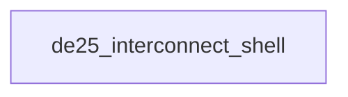

<!-- rr:fdd v1 ip=de25_interconnect_shell -->
# de25_interconnect_shell — Firmware Design Document

<!-- rr:fdd:generated:begin -->
<!-- rr:fdd:inputs sha256:617c86be47b5bfa1 -->
<!-- rr:fdd:projection v3 -->
> Machine-owned block — scaffolded by `rr fdd init`, refreshed by
> `rr fdd generate`. Do not edit inside the markers;
> edit the canonical declarative files it references. FDD state is
> documentation completeness only — never behavioral proof.

**IP:** `de25_interconnect_shell` v1.0

## Canonical References

- **Requirements** — `requirements.yml`: DE25-AXIL-001 (behavioral), DE25-AXIL-002 (behavioral), DE25-APB-001 (behavioral), DE25-APB-002 (negative), DE25-APB-003 (negative), DE25-AXIL-003 (negative), DE25-PORT-001 (negative)
- **Interfaces** — `requirements.yml` port_contract:
  - clocks: `HPS_CLK_25`, `HPS_ENET_RX_CLK`, `HPS_USB_CLK`
  - 50 scalar port(s)
  - _contract_: declared here from the contract — not proof the HDL matches; verify with `rr sim contract-check`
- **Registers** — none declared
- **Dependencies** — no `ip.yml`: none declared
- **Decisions** — no `decisions.yml`

## Requirements

| ID | Kind | Requirement |
|---|---|---|
| DE25-AXIL-001 | behavioral | AXI4-Lite offsets 0x00000, 0x10000, and 0x20000 select exactly one of the regbank, CTU-A, or CTU-B downstream interfaces respectively. |
| DE25-AXIL-002 | behavioral | Independently arriving AXI write-address and write-data channels are each accepted once and forwarded to the selected slave without ordering assumptions. |
| DE25-APB-001 | behavioral | A full-word access to either CTU window emits one APB setup phase followed by a stable access phase; PSEL, PADDR, PWRITE, and PWDATA remain stable while PREADY is low. |
| DE25-APB-002 | negative | If only AXI AW or only AXI W has arrived, the shim must not assert PSEL until both write halves have been accepted. |
| DE25-APB-003 | negative | A partial AXI write must produce no APB transfer and must return SLVERR, because the CTU APB interface has no byte strobes. |
| DE25-AXIL-003 | negative | An access in reserved offset window 0x30000 must assert no downstream valid and must return DECERR locally. |
| DE25-PORT-001 | negative | The portable deepskopion_core must not reference a vendor primitive library or instantiate either vendor's generated block-design/debug shell. |

## Register Map

none declared

## Block Diagram

## Decision Index

none declared
<!-- rr:fdd:generated:end -->

## Overview

This target-owned shell connects the vendor-neutral Deepskopion core to the
Agilex 5 HPS. It preserves the CPU-visible CSR and ring-memory contracts while
keeping Platform Designer and Intel primitives outside the portable core.

## Theory of Operation

The HPS lightweight bridge is narrowed to AXI4-Lite and decoded into three
64-KiB windows. Window zero drives the system regbank directly; windows one and
two pass through independent AXI-Lite-to-APB3 shims for the CTU cores. The
portable DDR writer drives the 256-bit f2sdram adapter. All fabric interfaces
share the 100 MHz `clk_sys` from the fabric IOPLL (`CLOCK2_50` x 2) and the
active-high `rst_sys`. `de25_reset_ctrl` holds `rst_sys` until SDM
initialization completes (`ninit_done` low) and the PLL locks (`pll_locked`
high); each source has its own 3-FF synchroniser into `clk_sys`, and the two are
combined in a register after the chains. The HPS fabric reset bridge takes
`rst_sys`.

## Architecture

The project-root `ip.yml` (`hps_regenerate: true` / `hps_emif: true`) declares the
HPS/EMIF subsystem by parameter; rr's own pre-synth HPS generator makes the HPS
and EMIF variants in `build/rr_ip_regen/`, renders the system and builds it
(no hand-authored qsys-script, no generated file in the source tree). `deepskopion_de25_top` owns
physical pins, reset, flat/record
AXI wiring, interrupt routing, and Intel REA. `axil_demux3`,
`lwh2f_axilite_bridge`, and the two `axil_apb_shim` instances form the CSR
plane; `deepskopion_core` contains all product behavior shared with Xilinx.
